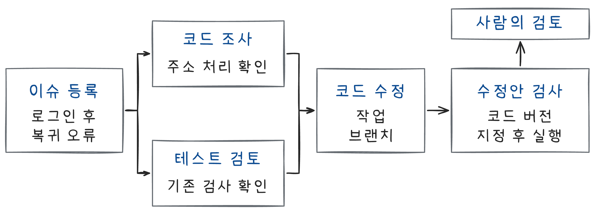

<!-- authoritative-lang: ko -->

# §17.3 개발 환경은 하나로 합쳐질까? {#sec-future-development-environments .unnumbered}

```{=html}
<style>
.ch17-table-layout table th + th,
.ch17-table-layout table td + td { border-left: 1px solid #a6a6a6; }
.ch17-table-layout table th,
.ch17-table-layout table td { padding: 0.35em 0.5em; vertical-align: top; }
.ch17-table-layout table td { border-bottom: 0.5px solid #d9d9d9; }
</style>
```

:::: {.ch17-table-layout}

```{=typst}
#[
#set table(
  inset: (x: 4pt, y: 3pt),
  stroke: (x, y) => (
    left: if x > 0 { 0.45pt + luma(65%) } else { none },
    right: none,
    top: none,
    bottom: 0.25pt + luma(85%),
  ),
)
```

통합 개발 환경(IDE)이 가져온 변화는 오류 메시지 한 줄만 눌러 봐도 알 수 있다. 프로그램을 실행하다 오류가 나면 편집기가 해당 파일의 문제 지점을 열어 준다. 빌드 도구는 여전히 프로그램을 만들고, 편집기는 여전히 파일을 연다. 달라진 것은 개발자가 빌드 결과에서 파일 이름과 줄 번호를 찾아 옮겨 적던 일이 사라졌다는 점이다.

에이전트에게 개발을 맡길 때도 비슷한 불편이 있다. 에디터 옆 대화창에서 오류의 원인을 찾았는데, 수정을 맡길 때는 다른 대화창을 열어 방금 알아낸 내용을 다시 설명한다. 테스트까지 끝난 뒤에는 어느 수정안으로 통과한 결과인지 찾아서 동료에게 보낸다. 세 도구가 한 화면에 떠 있어도 일의 앞뒤를 맞추는 사람은 여전히 개발자다. 반대로 대화창에서 일을 맡기고 코드 검토 화면에서 결과를 받더라도, 그사이의 일을 개발 환경이 이어 줄 수 있다면 개발자는 자리를 비울 수 있다.

그렇다면 에이전트 시대의 개발 환경에서 무엇이 하나가 될까? 이 절에서는 개발자가 맡기는 **이슈 한 건**을 단위로 살펴본다. 이슈에는 사용자가 겪은 문제와 고치려는 동작을 적는다. 일을 마치면 같은 이슈에서 수정안을 열고, 그 수정이 통했는지를 확인한다. 개발자는 일을 맡기는 자리와 결과를 검토하는 자리에 있다(@fig-17-3-1). 가운데에서는 동시에 할 수 있는 일이 갈라지고, 앞의 답이 있어야 할 수 있는 일은 차례를 기다린다.

::: {.content-visible when-format="html"}

{#fig-17-3-1 fig-alt="로그인 후 복귀 오류를 이슈로 등록하면 코드 조사와 테스트 검토가 나란히 진행된다. 두 결과가 모이면 작업 브랜치에서 코드를 수정하고 지정한 코드 버전을 검사한다. 이후 사람이 수정안을 검토한다."}

:::

::: {.content-visible when-format="typst"}

{#fig-17-3-1 fig-alt="로그인 후 복귀 오류를 이슈로 등록하면 코드 조사와 테스트 검토가 나란히 진행된다. 두 결과가 모이면 작업 브랜치에서 코드를 수정하고 지정한 코드 버전을 검사한다. 이후 사람이 수정안을 검토한다."}

:::

## 하나로 합쳐지는 창구와 결과

Stripe의 엔지니어들은 동료와 변경 사항을 논의하던 Slack 대화에서 사내 코딩 에이전트 Minions를 호출한다. 에이전트는 그 대화와 거기에 걸린 링크를 읽고, 별도의 개발 환경에서 코드를 수정한다. 변경 사항이 자동 검사를 거치면 에이전트가 풀 리퀘스트를 준비한다. 풀 리퀘스트는 바뀐 코드를 팀에 제안하고 검토를 받는 자리다. 엔지니어는 수정안을 살펴본 뒤 동료에게 검토를 요청하거나, 같은 작업에 보완을 지시할 수 있다. [\[1\]](#ref-17-3-1)

이 흐름에서 눈여겨볼 대목은 Slack에서 오간 논의가 어디까지 따라가는가이다. 동료가 앞서 설명한 조건이나 문제를 재현한 기록이 그 대화에 있다면, 일을 맡기는 사람이 처음부터 설명문을 새로 쓸 필요가 없다. 그렇다고 코드 검토까지 Slack에서 끝낼 필요도 없다. 바뀐 줄을 원래 코드와 대조할 때는 팀이 쓰던 검토 도구가 편하다. 요청을 받을 곳과 결과를 살필 곳을 각자 쓸모에 맞게 두면서도, 엔지니어가 둘 사이의 연락책을 맡는 수고를 덜 수 있다.

Stripe는 내부에서 모든 단계를 똑같은 방식으로 처리하지도 않는다. 어느 코드를 고칠지는 에이전트가 판단하지만, 정해진 검사 도구를 실행하고 변경을 올리는 단계는 미리 작성한 프로그램이 맡는다. 회사가 공개한 절차에서는 첫 공용 검사에 실패했을 때 에이전트가 결과를 받아 다시 고칠 수 있고, 같은 작업의 공용 검사는 두 차례까지 진행한다. 어디까지 자동으로 이어 가고 어느 지점에서 사람이 결과를 받아 볼지 개발 환경 안에 정해 둔 것이다. [\[2\]](#ref-17-3-2)[\[1\]](#ref-17-3-1)

Stripe가 공개한 것은 대화에서 시작한 요청이 검사를 거쳐 사람의 코드 검토로 돌아오는 방식이다. 이제 그 안에서 **이슈 하나의 일까지 나눠 맡기는 개발 환경**을 생각해 보자. 앞으로 살펴볼 분담은 이 절의 설계 예시다. 한 개발자가 사이트를 쓰다가 “글을 읽다 로그인하면 방금 읽던 글 대신 첫 화면이 열립니다”라는 제보를 이슈로 남겼다. 개발자가 받고 싶은 것은 이 문제를 고친 수정안이다. 어디를 왜 고쳤고 어떻게 확인했는지까지 읽을 수 있어야 일을 마칠 수 있다.

## 창구 뒤에서 나뉘는 역할과 작업 공간

개발자가 수정을 맡기면서 아는 범위에서 조건을 덧붙인다. 글을 보다가 로그인한 사람은 그 글로 돌아가야 한다. 첫 화면에서 바로 로그인한 사람은 지금처럼 첫 화면에 머물러야 한다. 첫 문장은 바꾸고 싶은 동작이고 두 번째 문장은 그대로 두고 싶은 동작이다. 원인이 어느 파일에 있는지, 어떤 테스트를 추가할지까지 적지는 않는다. 그것까지 찾아서 알려 줘야 접수할 수 있는 환경이라면 개발자가 이미 조사의 상당 부분을 끝낸 셈이다.

이슈를 받은 환경이 먼저 할 일은 그 부탁을 확인할 수 있는 질문으로 나누는 것이다. 코드 쪽에서 물을 질문은 “로그인하기 전에 알던 글 주소를 어느 지점에서 잃는가?”이다. 테스트 쪽에서 물을 질문은 “지금 검사는 로그인에 성공한 것만 확인하는가, 그 뒤에 열린 페이지도 확인하는가?”이다. 테스트를 읽는 데 코드 조사의 결론이 필요하지는 않다. 환경은 같은 버전의 코드를 기준으로 두 작업을 함께 시작하고, 각각의 답이 돌아올 자리를 이슈에 마련한다.

코드 조사 담당은 글 보기 화면에서 로그인 화면으로 넘어갔다가 다시 돌아오는 경로를 따라간다. 이 예에서는 로그인 화면을 열 때까지는 원래 주소가 남아 있지만, 로그인 성공 뒤에 실행되는 코드가 언제나 첫 화면을 연다고 하자. 그렇다면 다음 사람에게 넘길 것은 ‘주소 처리에 문제가 있음’이라는 요약만으로는 부족하다. 주소가 마지막으로 남아 있는 곳과 첫 화면을 선택한 줄을 함께 가리켜야 한다. 수정 담당은 조사자의 추측을 처음부터 되짚지 않고도 그 두 곳을 열어 설명이 맞는지 확인할 수 있다.

같은 시간에 테스트 담당은 이미 통과하고 있는 로그인 검사를 읽는다. 검사에는 로그인 버튼을 누르고 사용자 이름이 나타났는지 확인하는 절차가 있다. 글에서 시작했을 때 어느 페이지에 도착했는지를 살피는 절차는 없다. 이 담당자가 넘길 답은 기존 검사의 이름, 그 검사가 보장하는 동작, 아직 확인할 수 없는 동작이다. 이제 수정 담당은 기존 검사를 지켜야 할 이유와 새 검사를 추가해야 할 이유를 함께 안다. 테스트 전체를 읽고 같은 빈틈을 다시 찾을 필요가 없다.

두 조사에 ‘로그인 오류를 찾아 달라’는 같은 문장만 보냈다면 둘 다 로그인 함수를 읽고 비슷한 답을 냈을 수 있다. 둘로 나눌 만한 이유는 다음 단계에 **성격이 다른 두 답**이 필요하기 때문이다. 한쪽은 고칠 후보를 좁히고, 다른 쪽은 그 후보를 고쳤을 때 제보가 해결됐는지 판별할 방법을 찾는다. 파일 이름 하나를 확인하면 끝나는 일이라면 질문 하나를 그대로 처리하는 편이 간단하다. 개발자 입장에서는 매번 담당 수를 고를 필요 없이, 일을 맡길 때 어떤 결과를 받고 싶은지만 정할 수 있으면 된다.

**표 17.3-1. 이슈 안에서 나뉘는 일과 다음 단계에 넘길 결과**

| 맡은 일 | 언제 시작하나 | 다음에 넘기는 결과 |
|---|---|---|
| 코드 조사 | 이슈를 받으면 테스트 검토와 함께 | 원래 주소가 남아 있는 곳, 첫 화면을 여는 코드 위치 |
| 기존 테스트 검토 | 이슈를 받으면 코드 조사와 함께 | 기존 검사가 확인하는 동작, 빠져 있는 도착 페이지 조건 |
| 수정 | 두 조사 결과가 모이면 | 제보를 재현하는 테스트, 코드를 고친 이유, 수정안 |
| 검사 | 검사할 수정안이 준비되면 | 어느 버전에서 어느 동작을 확인했는지와 그 결과 |
| 사람의 검토 | 수정안과 그 버전의 검사 결과가 모이면 | 승인하거나, 보완할 조건을 같은 이슈에 남긴 기록 |

팀에 따라 표의 일을 배분하는 방식은 달라질 수 있다. 작은 저장소라면 한 에이전트가 코드와 테스트를 모두 읽어도 된다. 코드와 테스트를 다른 팀이 관리한다면 각 자료에 익숙한 담당에게 질문을 따로 보낼 수 있다. 어느 쪽이든 다음 사람은 앞 담당이 몇 명이었는지보다 어느 버전에서 무엇을 확인했는지를 알아야 한다.

## 두 조사 결과가 하나의 수정안이 되기까지

점심을 먹고 돌아온 개발자가 이슈를 열었다. 코드 조사는 끝났고 테스트 담당은 아직 파일을 읽고 있다. 두 세션의 맨 아래 메시지만 보여 주면 개발자는 여전히 어느 쪽을 기다려야 하는지 알아내야 한다. 이슈에 ‘코드 위치 확인됨, 테스트 검토가 끝나면 수정 시작’이라고 적혀 있다면 할 일이 분명하다. 테스트 검토가 끝나기를 기다리는 동안 개발자는 다른 일을 해도 된다.

이 순서를 관리하는 방법 가운데 하나가 작업 대기열, 즉 큐다. 작업을 도착한 순서대로 하나씩만 실행하면 코드 조사가 끝날 때까지 테스트 검토도 기다려야 한다. 각 작업에 시작 조건을 적어 두면 순서가 달라진다. 두 조사는 이슈를 접수한 즉시 시작할 수 있다. 수정은 두 결과를, 검사는 한 버전의 수정안을 기다린다. 먼저 끝난 조사 결과는 잠시 보관한다. 나중에 끝난 조사까지 같은 이슈에 도착하면 환경이 두 답을 묶어 수정 담당에게 넘긴다. 담당자에게 알림을 보내거나 새 작업을 여는 시점은 이렇게 정할 수 있다.

두 답이 서로 맞지 않을 수도 있다. 코드 조사에서는 로그인 뒤 글 주소를 쓰는 분기가 이미 있다고 하는데, 테스트 담당이 재현한 경로에서는 그 분기를 한 번도 지나지 않았다고 하자. 이 상태에서 두 보고를 이어 붙여 “원인을 확인했다”고 요약하면 모순이 감춰진다. 같은 버전의 코드에서 두 담당이 어느 로그인 경로를 따라갔는지 먼저 대조해야 한다. 경로 하나를 더 확인하면 풀릴 문제라면 그 조사만 다시 맡기고, 재현 절차가 모호하다면 제보자에게 어느 화면에서 로그인했는지 물을 수 있다. 이렇게 해야 두 담당이 다른 경로를 본 사실까지 수정 담당에게 전해진다.

두 조사가 같은 경로를 가리키는 것을 확인하면 수정 담당은 먼저 제보를 재현하는 테스트를 작성한다. 우선 제품 코드는 그대로 둔 채 테스트를 실행한다. 예상한 주소는 읽던 글인데 실제로 열린 주소는 첫 화면이다. 제보와 같은 이유로 실패했음을 확인한 뒤, 이미 보관하고 있던 주소를 로그인 성공 뒤에 사용하도록 코드를 고친다. 같은 테스트를 다시 돌렸을 때 이번에는 원래 글이 열린다. 첫 화면에서 바로 로그인하는 경로도 여전히 통과한다. 따로 출발한 두 조사는 이때 비로소 하나의 수정안을 뒷받침한다.

수정 전의 실패는 검토할 때도 쓸모가 있다. 새 테스트부터 돌렸는데 첫 화면으로 이동하기도 전에 로그인 자체가 실패했다면 어떨까? 화면에는 똑같이 실패 표시가 뜨지만 제보한 현상을 재현한 결과로 쓸 수는 없다. 수정 담당은 테스트용 계정이나 준비 절차를 다시 살펴야 한다. 따라서 다음 단계에 넘길 기록에는 실패 횟수와 함께 무엇을 기대했고 실제로 무엇을 보았는지가 남아야 한다. 개발자는 검사가 겨냥한 문제가 제보와 맞는지 두 줄의 주소만 읽고도 확인할 수 있다.

## 작업 공간은 나누고 진행 상황은 이슈에 남긴다

그동안 개발자 자신의 편집기에서는 다른 일이 진행될 수 있다. 조사 담당이 파일을 읽는 동안에는 같은 버전을 함께 보아도 되지만, 수정 담당이 개발자가 쓰던 폴더에 곧바로 파일을 쓰면 두 사람이 바꾼 줄이 섞인다. 이를 피하는 한 방법이 작업 폴더를 나누는 것이다. Git의 워크트리(worktree)는 하나의 저장소에 연결된 작업 폴더를 여럿 만들 수 있게 한다. 개발자는 자기 폴더에서 하던 일을 계속하고, 수정 담당은 별도 폴더에서 작업용 브랜치에 변경을 남길 수 있다. [\[3\]](#ref-17-3-3)

폴더를 따로 쓴 뒤에도 검토자를 헷갈리게 하는 일이 있다. 검사에 통과한 뒤 코드를 한 줄 더 고치면 이전 결과에는 마지막 한 줄이 들어 있지 않다. 반대로 수정 담당의 폴더에서만 코드를 고치고 그 변경을 넘기지 않았다면, 원격에서 실행한 검사는 예전 코드를 검사한 셈이다. 그래서 검사 담당에게 보낼 때는 이슈 번호와 함께 검사할 코드 버전을 지정한다. 돌아온 결과에도 그 버전을 적어 두면, 검토 화면은 지금 열어 본 변경을 실제로 검사했는지 알려 줄 수 있다.

검사할 수 있는 자료에도 경계가 있다. §17.2에서 다룬 접근 권한은 이슈를 다른 담당자에게 넘길 때 다시 문제가 된다. 제보를 재현한 원래 기록에 사용자의 정보가 섞여 있다면, 그 기록을 볼 권한이 있는 사람이 재현 절차와 테스트용 주소만 남길 수 있다. 수정 담당에게 필요한 것은 어떤 순서로 화면을 열었고 어디로 이동했는지다. 필요한 사실을 이슈에 담아 전달하면 원본 기록 전체를 열 권한까지 함께 넘길 이유가 줄어든다. 하나의 창구를 둔다고 해서 참여자 모두가 같은 자료를 보아야 하는 것은 아니다.

개발자가 창을 닫아도 이 순서를 이어 가려면 에이전트에게 일할 공간이 있어야 한다. 원격 컴퓨터 한 대를 빌려 코드와 검사 도구를 두면 개발자의 노트북이 꺼져 있는 동안에도 일이 진행될 수 있다. 다만 그 컴퓨터가 사라지면 이슈의 진행 상태까지 사라지도록 만들어서는 곤란하다. 검사 중에 컴퓨터가 종료됐다면 마지막 수정은 남아 있어도 검사 결과는 없을 수 있다. 다른 컴퓨터에서 같은 수정안을 꺼내 검사를 이어 가려면 이슈에 작업용 브랜치와 마지막 코드 버전, 끝까지 마친 단계가 남아 있어야 한다.

이슈의 기록은 사람이 말을 덧붙일 때도 쓰인다. 검사가 도는 동안 개발자가 휴대폰에서 “첫 화면에서 바로 로그인하는 경로도 확인했나요?”라고 묻는다. 처음 맡긴 이슈에서 물었다면 이미 합의한 두 번째 조건이다. 환경은 검사 목록에서 그 항목을 찾아 진행 중이면 기다리는 이유를, 끝났으면 그 결과를 보여 줄 수 있다. 개발자는 아침에 어느 세션에 무엇을 지시했는지 떠올릴 필요가 없다. 기기가 달라져도 같은 작업을 이어 간다는 말은 이처럼 짧은 질문에도 적용된다.

반대로 개발 환경이 결정할 수 없는 갈림길도 있다. 사용자가 로그인하는 사이에 읽던 글이 삭제됐다면 첫 화면으로 보낼까, 글을 더 이상 볼 수 없다고 안내할까? 둘 다 프로그램이 정상적으로 실행되는 동작이다. 기존 제품 규칙에서 답을 찾을 수 없다면 개발자나 제품 담당자에게 물어야 한다. 이때는 ‘도움이 필요합니다’보다 ‘글이 남아 있는 경우는 검사를 마쳤습니다. 삭제된 경우 보여 줄 화면을 정해 주세요’라는 질문이 낫다. 무엇을 결정하면 되고 어디까지 끝났는지가 한 번에 보인다. 답이 돌아오면 그 결정을 기다리던 일부터 재개할 수 있다.

이런 개발 환경은 일부 역할에서 운영체제를 닮는다. 운영체제는 여러 프로그램이 한 컴퓨터를 쓰도록 각각 공간을 주고, 실행할 차례를 정하고, 기다리던 입력이 들어오면 일을 재개한다. 개발 환경도 여러 이슈의 작업 장소와 권한을 나누고, 필요한 결과나 사람의 답이 도착하면 다음 일을 시작할 수 있다. 누가 어느 답을 기다리는지 환경이 기억하면, 개발자는 사람 한 명에게 부탁하듯 이슈 한 건을 맡길 수 있다.

## 하나로 보이는 것과 하나로 이어지는 것

개발자가 마지막으로 이슈를 열 때에는 중간 단계의 진행 표시보다 검토할 자료가 먼저 보여야 한다. 개발자가 받아 볼 것은 팀의 코드에 반영할지 결정할 수정안 한 건이다. 바뀐 줄은 코드 검토 화면에서 보고, 필요하면 처음의 제보나 검사 기록으로 돌아갈 수 있으면 된다. 앞의 이슈라면 검토자는 다음과 같은 내용을 받는다.

**표 17.3-2. 개발자가 이슈에서 받아 보는 검토 자료의 예**

| 검토할 항목 | 이슈에서 읽을 내용 |
|---|---|
| 요청한 동작 | 글에서 로그인하면 읽던 글로 돌아간다. 첫 화면에서 시작하면 첫 화면에 머문다. |
| 바꾼 부분 | 로그인 성공 뒤에 보관해 둔 글 주소를 사용한다. 글을 거치지 않고 로그인했을 때의 기본 경로는 유지했다. |
| 검사로 확인한 범위 | 글에서 시작한 경로는 수정 전 실패하고 수정 후 통과했다. 첫 화면에서 시작한 경로도 수정 후 통과했다. 각 검사 기록에서 코드 버전을 확인할 수 있다. |
| 사람이 정할 부분 | 로그인 도중 글이 삭제됐을 때의 화면은 별도 결정이 필요하다. 이번 변경에 포함할지, 후속 이슈로 남길지 검토한다. |

검토자는 이 표에서 궁금한 부분만 골라 원래 기록을 펼쳐 볼 수 있다. 원인을 더 알고 싶다면 주소가 있었는데도 첫 화면을 열던 코드로 간다. 검사 범위가 마음에 걸리면 테스트에서 사용자가 어떤 상태로 로그인을 시작했는지 읽는다. 두 경우 모두 담당자를 다시 불러 설명을 들을 필요가 없다. 조사 결과를 모아 둔 보람은 모든 기록을 한 번에 읽을 수 있을 때보다, 검토자가 자기 질문에 해당하는 기록을 바로 찾을 때 드러난다.

보완할 점이 눈에 띄면 검토하던 자리에서 지적한다. 가령 검토자가 테스트 두 개를 읽어 보니 두 검사 모두 새 브라우저에서 시작한다. 그렇다면 앞서 글 하나를 읽었던 사용자가 로그아웃했다가 첫 화면에서 다시 로그인하는 경우는 어떨까? 검토자는 “전에 읽은 글 주소가 남아 있어도 첫 화면에서 로그인하면 그 글로 가지 않는지 확인해 주세요”라고 남긴다. 이미 합의한 두 번째 조건이므로 테스트부터 보강할 수 있다. 통과하면 새 검사 결과를 붙이고, 실패하면 어떤 순서에서 예전 주소가 남았는지 수정 담당에게 돌려보낸다. 두 번째로 이슈를 열었을 때는 지난 검토 뒤 무엇을 더 확인했는지가 먼저 보이는 편이 좋다. 검토자는 자신이 물었던 조건부터 확인하고 승인 여부를 정할 수 있다.

승인도 이렇게 범위를 정해 내리는 결정이다. 읽던 글이 남아 있는 경우와 첫 화면에서 로그인하는 경우를 확인했다면 검토자는 그 범위의 변경을 승인할 수 있다. 삭제된 글의 처리까지 이번에 정하기로 했다면 답이 올 때까지 승인을 보류한다. 후속 작업으로 미루기로 했다면 이번 변경의 범위와 남은 질문을 서로 연결해 둔다. 어느 경우든 코드를 쓸 수 있는 권한과 팀의 코드에 그 변경을 받아들일 권한은 구별된다. 환경이 인계를 잘 맡을수록 개발자는 어디에 개입해야 하는지 더 정확히 알 수 있다.

그렇다면 개발 환경은 어디까지 하나로 합쳐질까? **개발자가 처음 맡긴 이슈를 다시 열었을 때, 거기서 변경을 받아들일지 결정할 수 있는 데까지다.** 에디터에서 시작했는지 대화창에서 시작했는지는 덜 중요하다. 자리를 비운 사이에 다른 도구가 조사와 수정을 이어 갈 수 있고, 돌아와서는 부탁한 동작과 실제로 바뀐 동작을 한자리에서 비교할 수 있는지가 중요하다. 그 안에서는 조사할 권한, 바꿀 공간, 검사한 버전, 승인할 사람이 계속 구별된다. 그래야 개발자가 돌아온 수정안을 자신의 판단으로 받아들일 수 있다.

이 방식에도 경계가 하나 남는다. 팀이 다음 달에 조사 도구나 코딩 에이전트를 바꾸면, 지금 이슈에 남긴 요청과 검사 결과를 새 도구에서도 읽을 수 있을까? 작업 순서와 결정이 한 제품의 대화 기록에만 남으면 개발자가 다시 도구 사이에서 설명을 옮겨야 한다. 어떤 기록과 작업 규칙을 프로젝트에 남겨야 환경을 바꾸어도 같은 일을 이어 갈 수 있는지, 다음 절에서 살펴본다.

::: {.callout-tip}
## 개발 도구 선택 전 핵심 점검 항목

- 요청을 한 번 남긴 뒤, 개발자가 어느 단계에서 다시 자료를 옮기거나 다음 작업을 지시해야 하는가?
- 동시에 조사한 두 담당의 답이 다를 때, 어떤 코드와 어떤 조건을 읽었는지 확인할 수 있는가?
- 검토 중인 수정안과 실제로 검사한 코드 버전이 일치하는가?
- 검사에 시간이 필요한 이슈와 사람의 결정이 필요한 이슈가 구별되는가?
- 보완을 요청했을 때 지난 검토 이후의 변경과 새 검사 결과를 바로 찾을 수 있는가?

:::

::: {.callout-note collapse="true"}
## 토론 질문

- 일을 더 잘게 나누면 언제 결과가 빨리 돌아오고, 언제 중간 결과를 맞추는 수고만 늘어날까?
- 이슈 한 건을 맡긴 개발자가 마지막 승인 전에 꼭 직접 내려야 할 판단은 무엇일까?

:::

```{=typst}
]
```

::::

## 참고 자료 {.unnumbered}

::: {#ref-17-3-1}
[1] [Alistair Gray (Stripe), Minions: Stripe’s one-shot, end-to-end coding agents](https://stripe.dev/blog/minions-stripes-one-shot-end-to-end-coding-agents). (확인: 2026-11-18; 2026-02-09 게시).
:::

::: {#ref-17-3-2}
[2] [Alistair Gray (Stripe), Minions: Stripe’s one-shot, end-to-end coding agents—Part 2](https://stripe.dev/blog/minions-stripes-one-shot-end-to-end-coding-agents-part-2). (확인: 2026-11-18; 2026-02-19 게시).
:::

::: {#ref-17-3-3}
[3] [Git, git-worktree](https://git-scm.com/docs/git-worktree). (확인: 2026-11-18; Git 공식 명령어 문서).
:::
