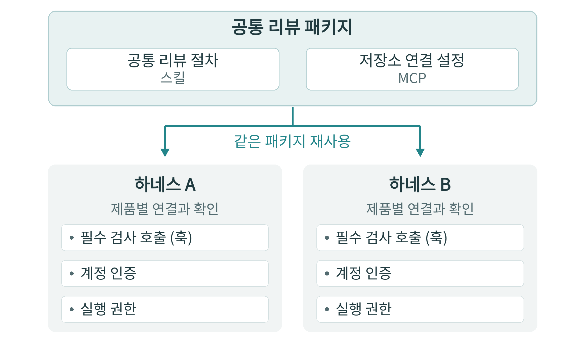
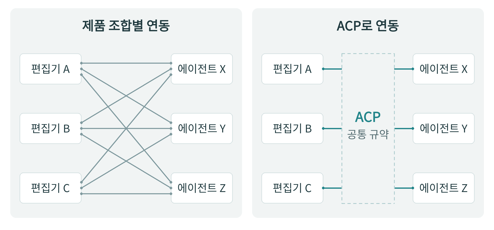
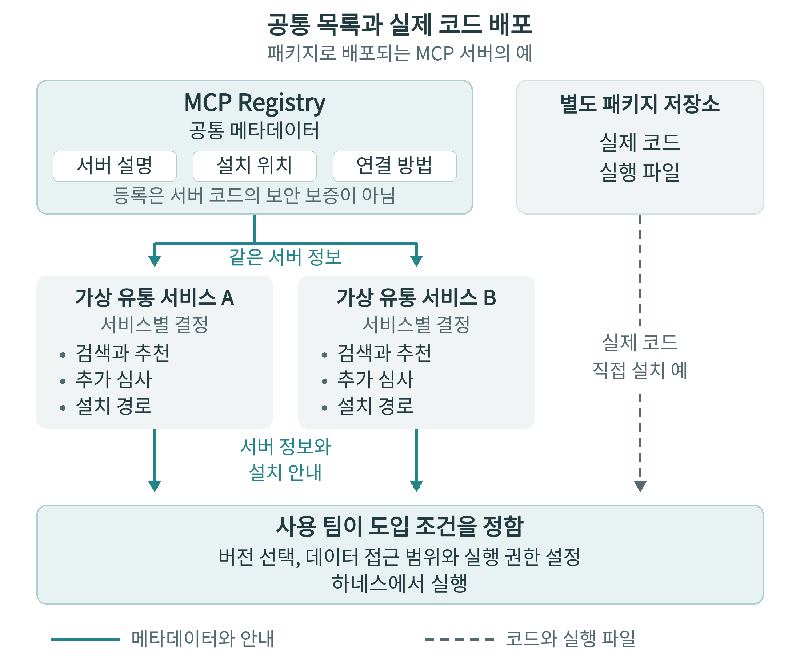

<!-- authoritative-lang: ko -->

# §17.4 하네스와 도구 프로토콜의 표준화 {.unnumbered}

## 도구를 바꿀 때 발생하는 비용 {.unnumbered}

팀이 코딩 도구를 교체하려면 기존의 프로젝트 규칙과 스킬, 외부 서비스 연결 설정을 새 도구에서 사용할 수 있는지 확인해야 한다. 새 도구가 기존 형식을 지원하지 않으면 팀은 규칙이나 절차를 다시 작성하고 연결 설정을 고쳐야 한다. 이런 작업에 드는 시간과 인력도 도구의 전환 비용에 포함된다.

하네스는 모델에 작업 정보를 전달하고 도구 실행과 권한을 관리한다. 여러 하네스가 같은 스킬 형식을 지원하면 팀은 업무 절차의 본문을 다시 작성하지 않고 재사용할 수 있다. 그러나 각 하네스가 스킬을 언제 불러오고 어떤 도구를 호출하며 어디까지 실행을 허용하는지는 다를 수 있다. 업무 자산을 다른 환경에서 이어 쓸 수 있는 정도를 이식성이라고 한다. 이식성을 판단할 때에는 재사용할 내용과 새 환경에서 다시 연결할 기능을 나누어 봐야 한다.

## 스킬과 도구 연결을 함께 배포하는 규격 {.unnumbered}

Agent Plugins는 스킬과 MCP 서버 설정을 하나의 묶음으로 배포하기 위한 공개 규격이다. 플러그인은 에이전트에 기능을 추가하는 배포 묶음이며, 클라이언트는 그 묶음을 읽고 실행하는 제품을 뜻한다. Agent Plugins 1.0.0은 스킬과 MCP 서버 설정을 둘 위치와 클라이언트가 이를 찾아 읽는 방법을 정한다. 이 규격을 지원하는 제품에 배포할 때에는 스킬과 MCP 설정을 제품마다 다른 구조로 다시 포장하는 일을 줄일 수 있다 [\[1\]](#ref-17-4-1).

Agent Plugins의 공식 호환 목록에는 VS Code, Cursor, ChatGPT와 Codex 등이 올라 있으며, 제품별 스킬 지원 여부와 MCP 연결 방식별 지원 여부가 표시되어 있다 [\[2\]](#ref-17-4-2). 명세는 클라이언트가 일부 구성요소만 지원하는 것도 허용한다. 스킬만 지원하는 제품도 관련 요건을 충족하면 규격에 적합할 수 있다. 따라서 사용자는 ‘Agent Plugins 지원’이라는 표시를 보더라도 자신에게 필요한 MCP 연결 방식까지 지원하는지 따로 확인해야 한다 [\[1\]](#ref-17-4-1).

가상 사례로, 한 팀이 두 종류의 하네스에서 같은 코드 리뷰 절차를 쓰려 한다고 하자. 팀은 변경 범위 확인, 테스트 결과 확인, 사람에게 검토 요청하기라는 절차를 스킬로 작성한다. 코드 저장소 서비스에 연결할 방법은 MCP 서버 설정에 적고, 두 구성요소를 하나의 리뷰 플러그인으로 묶는다. 두 하네스가 필요한 구성요소와 연결 방식을 모두 지원하면 팀은 같은 패키지를 배포할 수 있다. 팀은 각 하네스에서 저장소 서비스의 계정을 인증하고 에이전트에게 허용할 실행 범위를 설정해야 한다. Agent Plugins는 설치와 갱신, 권한 승인과 실행 격리 방식을 통일하지 않는다 [\[3\]](#ref-17-4-3).

이 팀이 리뷰를 시작할 때 필수 검사 명령을 자동으로 실행하려 한다고 하자. 특정 시점에 명령을 호출하는 훅(hook)은 Agent Plugins 1.0의 공통 구성요소에 포함되지 않는다. 제작자가 훅을 제품별 확장으로 패키지에 넣을 수는 있지만, 클라이언트는 자신이 구현하지 않은 확장을 무시한다 [\[1\]](#ref-17-4-1). 팀은 각 하네스의 훅으로 필수 검사를 실행할 수 있는지 확인하고 검사 명령을 연결해야 한다. 훅을 지원하지 않는 하네스에서는 모든 구성원이 공유하는 자동 검사 환경에서 통과 여부를 확인한 뒤 사람이 리뷰를 승인하도록 절차를 구성할 수 있다. 공통 스킬을 읽는 기능과 필수 검사를 실행하는 기능은 따로 확인해야 한다.

::: {.content-visible when-format="html"}

{#fig-17-4-4 fig-alt="공통 리뷰 절차와 저장소 연결 설정을 담은 패키지를 하네스 A와 B에서 재사용한다. 검사 호출, 계정 인증과 실행 권한은 각 하네스 환경에 맞춰 확인한다."}

:::

::: {.content-visible when-format="typst"}

{#fig-17-4-4 fig-alt="공통 리뷰 절차와 저장소 연결 설정을 담은 패키지를 하네스 A와 B에서 재사용한다. 검사 호출, 계정 인증과 실행 권한은 각 하네스 환경에 맞춰 확인한다."}

:::

## 공통 절차와 제품별 실행을 나누는 방식 {.unnumbered}

Superpowers는 계획 작성, 테스트 주도 개발, 코드 리뷰 등의 개발 절차를 스킬로 제공하는 도구 묶음이다. 테스트 주도 개발에서는 실패하는 테스트를 먼저 작성한 뒤 구현을 고친다. Superpowers 7.0.2의 설치 안내는 하네스별로 나뉘어 있다 [\[4\]](#ref-17-4-4). 다른 하네스로 옮기는 지침도 공통 스킬 본문과 제품별 도구 연결, 시작 시 안내를 전달하는 방법을 구분한다 [\[5\]](#ref-17-4-5).

예를 들어 Superpowers 7.0.2의 Codex용 설정은 공통 스킬 경로를 가리키며, 훅 설정은 비어 있다 [\[6\]](#ref-17-4-6). Codex는 자체 스킬 기능으로 Superpowers 스킬을 읽고, Superpowers의 세션 시작 훅은 실행하지 않는다 [\[5\]](#ref-17-4-5). Superpowers 제작자는 개발 절차의 본문을 공통으로 관리하고, 그 절차를 모델에 제시하거나 실제 도구 호출로 연결하는 방법은 하네스마다 맞춘다. 사용자는 각 하네스에서 에이전트가 남긴 계획과 리뷰 기록, 테스트 결과를 확인해야 한다.

Vercel Labs의 Skills CLI 1.7.6은 스킬의 설치와 갱신을 돕는 명령줄 도구다. 저장소나 로컬 자료에서 스킬을 가져와 하네스가 읽는 위치에 설치한다. 사용자는 여러 하네스가 하나의 설치 사본을 공유하게 하거나, 하네스마다 독립된 사본을 둘 수 있다. CLI는 설치한 스킬의 갱신을 확인하고 적용하는 기능도 제공한다 [\[7\]](#ref-17-4-7). 이 도구가 설치하는 대상은 스킬이며, 제품별 훅을 포함한 플러그인 전체를 자동으로 변환하지는 않는다. 여러 하네스가 공유하는 설치본은 제작자가 원격 저장소에서 관리하는 원본과는 별개다. 제작자가 원본을 수정했다고 팀이 승인해 둔 설치본까지 자동으로 바뀌는 것은 아니다.

앞의 리뷰 사례에서 팀은 공통 스킬의 본문과 승인한 버전을 관리한다. 리뷰 기준을 바꿀 때에는 공통 본문을 수정하고, 하네스를 교체할 때에는 검사 호출과 저장소 접근 권한을 대상 환경에 맞춘다. 이렇게 관리하면 팀은 업무 절차 전체를 다시 작성하는 대신 제품별 연결을 수정하고 검사 결과를 확인하는 데 집중할 수 있다.

## 편집기와 에이전트를 따로 고르는 연결 {.unnumbered}

Agent Client Protocol(ACP)은 코드 편집기와 코딩 에이전트 사이의 통신 규약이다. 공통 규약이 없으면 편집기 개발자와 에이전트 개발자는 제품 조합마다 별도 연동을 만들어야 한다. ACP를 지원하는 편집기와 에이전트가 호환되는 기능을 제공하면, 사용자는 익숙한 편집기를 유지하면서 다른 에이전트를 연결할 수 있다 [\[8\]](#ref-17-4-8). 플러그인 규격이 업무 절차와 도구 설정의 재사용을 돕는다면, ACP는 편집기와 에이전트를 따로 선택할 수 있게 연결하는 역할을 한다.

::: {.content-visible when-format="html"}

{#fig-17-4-5 fig-alt="왼쪽은 편집기 A, B, C와 에이전트 X, Y, Z를 제품 조합마다 별도로 연결한다. 오른쪽은 각 제품이 ACP 공통 규약을 구현해 연동한다."}

:::

::: {.content-visible when-format="typst"}

{#fig-17-4-5 fig-alt="왼쪽은 편집기 A, B, C와 에이전트 X, Y, Z를 제품 조합마다 별도로 연결한다. 오른쪽은 각 제품이 ACP 공통 규약을 구현해 연동한다."}

:::

ACP v1은 편집기가 같은 컴퓨터에서 에이전트를 실행하고 표준 입출력(stdio)으로 통신하는 방식을 정의한다. 원격 연결을 위한 공통 Streamable HTTP 방식은 설계 중이며, 제품 개발자가 별도 전송 방식을 구현할 수도 있다 [\[9\]](#ref-17-4-9). 따라서 편집기와 에이전트가 로컬에서 연결된다고 원격에서도 같은 방식으로 연결되는 것은 아니다. §17.3에서 다룬 원격 실행 환경에 ACP를 적용하려면 선택한 편집기와 에이전트가 같은 원격 연결 방식을 제공하는지 확인해야 한다.

ACP v1의 세션 불러오기는 해당 기능을 지원하는 에이전트가 자신이 관리하던 세션을 다시 열고 기존 대화를 제공하는 절차다. 한 에이전트의 내부 작업 상태를 다른 에이전트가 사용하는 형태로 변환하는 절차는 정하지 않는다 [\[10\]](#ref-17-4-10). 앞의 팀이 편집기는 그대로 쓰면서 리뷰를 다른 에이전트에 맡긴다면, 새 에이전트가 기존 판단과 남은 작업을 파악할 수 있도록 정보를 전달할 방법도 마련해야 한다. 편집기 연동을 공통화해도 진행 중인 작업을 다른 에이전트에 설명하는 데 드는 수고는 남는다.

## 공통 목록과 제품별 유통 경로 {.unnumbered}

MCP Registry는 공개적으로 접근할 수 있는 MCP 서버의 공식 목록이다. 서버의 설명과 설치 위치, 연결 방법 등의 메타데이터를 제공하며, 서버의 코드나 실행 파일을 직접 보관하지는 않는다. Registry는 정식 운영 전의 사전 공개(preview) 상태다. 정식 운영 전에 데이터가 초기화되거나 호환되지 않는 변경이 생길 수 있다 [\[11\]](#ref-17-4-11).

마켓플레이스 같은 유통 서비스는 Registry의 정보를 가져와 추천 목록과 평가, 추가 검사를 제공할 수 있다. Registry는 게시자의 계정이나 도메인 소유권을 확인하고, 실제 서버 코드의 보안 검사는 패키지 저장소와 하위 유통 서비스에 맡긴다 [\[11\]](#ref-17-4-11). 따라서 팀은 목록에 등록되어 있다는 이유만으로 서버 실행을 허용해서는 안 된다. 앞의 팀이 저장소 연결용 서버를 도입한다면, 게시자와 채택할 버전, 검사 결과를 확인하고 서버가 어떤 데이터에 접근하도록 허용할지 정해야 한다.

::: {.content-visible when-format="html"}

{#fig-17-4-6 fig-alt="MCP Registry는 서버 설명과 설치 위치 등의 메타데이터를 제공하고 패키지 저장소는 실제 코드를 제공한다. 유통 서비스는 공통 정보를 이용해 검색과 심사를 제공하며, 팀은 도입할 버전과 접근 권한을 정한다."}

:::

::: {.content-visible when-format="typst"}

{#fig-17-4-6 fig-alt="MCP Registry는 서버 설명과 설치 위치 등의 메타데이터를 제공하고 패키지 저장소는 실제 코드를 제공한다. 유통 서비스는 공통 정보를 이용해 검색과 심사를 제공하며, 팀은 도입할 버전과 접근 권한을 정한다."}

:::

스킬을 찾을 때에는 skills.sh 같은 서비스도 이용할 수 있다. skills.sh는 설치 수 집계를 순위에 사용하며, 등록된 모든 스킬의 품질과 보안을 보장하지는 않는다 [\[12\]](#ref-17-4-12). 팀은 설치 순위와 별개로 해당 스킬이 자신의 저장소와 리뷰 기준에 맞는지 검토해야 한다. 같은 형식으로 배포된 스킬이라도 유통 서비스가 선택한 정렬 기준에 따라 사용자에게 노출되는 순서는 달라질 수 있다.

| 공통화의 대상 | 줄일 수 있는 전환 작업 | 여전히 확인할 부분 |
|---|---|---|
| Agent Plugins의 패키지 구조 | 스킬과 MCP 설정을 제품마다 다시 포장하기 | 지원 구성요소와 연결 방식, 제품별 확장, 설치와 권한 |
| ACP의 편집기 연결 | 편집기와 에이전트 조합마다 별도 연동 만들기 | 실제 지원 기능과 전송 방식, 기존 작업 상태의 전달 |
| MCP Registry의 서버 정보 | 서버 설명과 설치 정보를 유통 경로마다 별도로 수집하기 | 서비스별 노출과 추가 심사, 도입할 코드와 버전 |

팀이 리뷰 플러그인을 공통 형식으로 배포하더라도, Agent Plugins 규격이 유통 서비스의 검색 순위나 등록 심사를 통일하지는 않는다 [\[3\]](#ref-17-4-3). 플러그인 제작자는 패키지와 별도로 배포 경로를 유지해야 한다. 사용자는 유통 서비스를 바꾸더라도 같은 원본과 버전을 확보하고 갱신할 수 있는지 확인해야 한다.

## 공동 운영과 앞으로의 경쟁 {.unnumbered}

Linux Foundation은 2025년 12월 9일 Agentic AI Foundation(AAIF)의 설립을 발표했다. 초기 기여 프로젝트는 MCP, 오픈소스 에이전트 프레임워크 goose, `AGENTS.md`다 [\[13\]](#ref-17-4-13). AAIF 기술위원회는 신규 프로젝트를 검토하고 프로젝트 사이의 협력을 조정한다. 기술위원회 헌장은 위원회의 역할과 참여 방식을 정한다 [\[14\]](#ref-17-4-14). 표준을 도입하는 조직과 도구 제작자는 이 운영 규정을 통해 변경 제안을 논의할 경로와 의사결정 절차를 살펴볼 수 있다.

Agent Plugins는 독립적으로 운영되는 공개 규격이며 AAIF 프로젝트가 아니다 [\[3\]](#ref-17-4-3). AAIF의 프로젝트 운영 규정, Agent Plugins의 패키지 규격, 개별 하네스의 실행 정책은 서로 다른 대상을 다룬다. 공동 재단이 있다는 사실이 각 하네스의 기능과 권한 설정까지 같게 만들지는 않는다.

::: {.content-visible when-format="html"}

{#fig-17-4-3 fig-alt="사용자와 도입 기업이 공통 자산을 관리하며 하네스는 실행과 권한, 스킬 및 도구 제공자는 절차와 기능, 유통 계층은 발견과 배포 경로를 맡는다."}

:::

::: {.content-visible when-format="typst"}

{#fig-17-4-3 fig-alt="사용자와 도입 기업이 공통 자산을 관리하며 하네스는 실행과 권한, 스킬 및 도구 제공자는 절차와 기능, 유통 계층은 발견과 배포 경로를 맡는다."}

:::

그림의 ‘유통 계층’은 자산을 찾고 설치하고 갱신하는 서비스를 뜻한다. 하네스 운영자는 실행 권한과 사용자 인터페이스를 정하고, 유통 서비스 운영자는 검색과 설치 경로를 정한다. 한 기업이 하네스와 유통 서비스를 함께 운영할 수도 있다.

공통 패키지를 지원하는 하네스가 늘어나면, 팀은 기존 업무 절차를 유지하면서 다른 하네스를 시험하기 쉬워질 수 있다. 앞의 팀은 같은 초기 코드와 승인한 리뷰 절차를 각 하네스에 제공한 뒤, 각 하네스가 필수 검사를 수행하고 검토 근거를 남기는지 비교할 수 있다. 절차를 옮기는 부담이 줄어들면 사용자는 실행 도구를 비교하는 데 시간을 더 쓸 수 있다. 하네스 제공자는 답변의 정확도와 함께 실패한 작업을 복구하는 기능, 실행을 통제하는 기능, 검사 결과를 검토하는 편의로 차이를 보이려 할 수 있다.

팀이 필수 검사 절차를 특정 하네스의 훅과 승인 화면에만 구현해 두면, 도구를 바꿀 때 그 연결을 다시 만들어야 한다. 팀이 검색과 설치에도 한 서비스만 이용한다면 다른 경로에서 같은 자산을 확보하고 갱신할 방법을 마련해야 한다. 공통 형식을 채택하는 제품이 늘어도 팀의 핵심 업무 절차가 제품별 확장에 더 많이 의존하게 된다면, 전환 비용은 여전히 남을 수 있다.

개인은 공통으로 쓸 수 있는 업무 절차를 바탕으로 자신에게 맞는 하네스를 비교할 수 있다. 조직은 승인한 절차의 원본과 버전, 배포 경로를 관리하면서 여러 하네스를 도입할 수 있다. 도구를 바꿀 준비가 되었는지 판단하려면 지원 제품의 수를 세는 것보다, 자신의 업무에서 어떤 부분을 다시 구성해야 하는지 살펴야 한다. 특히 필수 검사와 승인 기준을 새 환경에서도 유지할 수 있는지가 도구 교체의 조건이 된다.

사용자는 모델의 능력과 실행 위치, 운영 역량, 개발 환경을 고려해 현재 업무에 맞는 도구를 고른다. 업무 자산의 이식성까지 함께 고려하면 모델과 도구가 바뀌어도 유지할 작업 절차와 검토 기준을 미리 정할 수 있다.

::: {.callout-tip}
## 도구를 바꾸기 전에 확인할 것

- 팀의 업무 절차 중 공통 스킬과 도구 설정으로 보존할 부분은 무엇인가?
- 새 하네스는 필요한 구성요소와 연결 방식을 지원하는가? 필수 검사를 실행하려면 어떤 연결을 다시 만들어야 하는가?
- 편집기를 유지하면서 에이전트를 바꿀 수 있는가? 진행 중인 작업 정보는 새 에이전트에 어떻게 전달하는가?
- 팀이 승인한 원본과 버전을 다른 유통 경로에서도 확보하고 갱신할 수 있는가?
- 같은 초기 코드와 완료 기준으로 비교했을 때, 각 하네스에서 다시 설정하거나 검사해야 하는 부분은 무엇인가?
:::

::: {.callout-note collapse="true"}
## 토론 질문

- 공통 패키지가 널리 지원되면 사용자는 하네스의 어떤 실행 기능을 더 중요하게 비교하게 될까?
- 팀은 제품 고유 기능의 편의와 그 기능을 다른 하네스에서 다시 구현하는 부담을 어떻게 비교해야 할까?
- 여러 유통 서비스가 같은 목록을 이용해도 검색 순위와 설치 정책이 다르다면, 제작자와 사용자의 선택은 어떤 영향을 받을까?
:::

## 참고 자료 {.unnumbered}

::: {#ref-17-4-1}
[1] [Agent Plugins, Agent Plugins Specification](https://agent-plugins.org/specification). (확인: 2026-11-08; 규격 버전: 1.0.0 공개판; 관련 조항: §7, §8, §11).
:::

::: {#ref-17-4-2}
[2] [Agent Plugins, Compatible Clients](https://agent-plugins.org/compatible-clients). (확인: 2026-11-08; 제품별 구성요소와 연결 방식의 지원표; 적용 제품 버전 별도 미표시).
:::

::: {#ref-17-4-3}
[3] [Harald Kirschner, From Skills and Tools to Portable Agent Plugins](https://aaif.io/blog/from-skills-and-tools-to-portable-agent-plugins). (확인: 2026-11-08; 2026-08-06 게시; Agent Plugins 기술운영위원회의 기고; 규격: 1.0).
:::

::: {#ref-17-4-4}
[4] [obra, Superpowers](https://github.com/obra/superpowers/blob/v7.0.2/README.md). (확인: 2026-11-08; 제품: Superpowers; 버전: 7.0.2).
:::

::: {#ref-17-4-5}
[5] [obra, Porting Superpowers to a new harness](https://github.com/obra/superpowers/blob/v7.0.2/docs/porting-to-a-new-harness.md). (확인: 2026-11-08; 제품: Superpowers; 버전: 7.0.2).
:::

::: {#ref-17-4-6}
[6] [obra, Superpowers Codex plugin manifest](https://github.com/obra/superpowers/blob/v7.0.2/.codex-plugin/plugin.json). (확인: 2026-11-08; 제품: Superpowers; 버전: 7.0.2; 공통 스킬 경로와 hooks 설정).
:::

::: {#ref-17-4-7}
[7] [Vercel Labs, CLI reference](https://github.com/vercel-labs/skills/blob/v1.7.6/docs/commands.md). (확인: 2026-11-08; 제품: Skills CLI; 버전: 1.7.6).
:::

::: {#ref-17-4-8}
[8] [Agent Client Protocol, Introduction](https://agentclientprotocol.com/get-started/introduction). (확인: 2026-11-08; 규격: ACP; 이 절의 확인 기준: v1).
:::

::: {#ref-17-4-9}
[9] [Agent Client Protocol, Transports](https://agentclientprotocol.com/protocol/v1/transports). (확인: 2026-11-08; 규격 버전: ACP v1).
:::

::: {#ref-17-4-10}
[10] [Agent Client Protocol, Session Setup](https://agentclientprotocol.com/protocol/v1/session-setup). (확인: 2026-11-08; 규격 버전: ACP v1; 관련 항목: Loading sessions).
:::

::: {#ref-17-4-11}
[11] [Model Context Protocol, The MCP Registry](https://modelcontextprotocol.io/registry/about). (확인: 2026-11-08; 상태: preview; 서비스 버전 별도 미공개).
:::

::: {#ref-17-4-12}
[12] [Vercel, Documentation](https://www.skills.sh/docs). (확인: 2026-11-08; 서비스: skills.sh; 서비스 버전 별도 미공개).
:::

::: {#ref-17-4-13}
[13] [Agentic AI Foundation, Linux Foundation Announces the Formation of the Agentic AI Foundation (AAIF), Anchored by New Project Contributions Including Model Context Protocol (MCP), goose and AGENTS.md](https://aaif.io/news/linux-foundation-announces-formation-of-aaif). (확인: 2026-11-08; 2025-12-09 발표).
:::

::: {#ref-17-4-14}
[14] [Agentic AI Foundation, Charter for the Technical Committee of the Agentic AI Foundation](https://github.com/aaif/technical-committee/blob/main/governance/charter.md). (확인: 2026-11-08; 2026-03-03 채택본; 관련 조항: §1, §2).
:::
