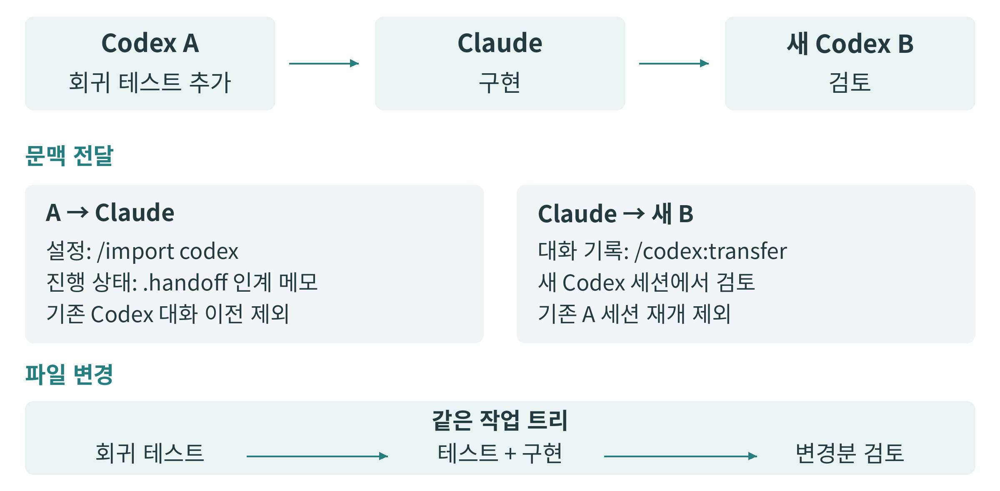

<!-- authoritative-lang: ko -->

# §17.4 하네스와 도구 프로토콜의 표준화 {.unnumbered}

**이식성과 표준화 그리고 생태계 주도권**

17.4 | 김현우

## 도구를 바꿀 때 무엇을 잃는가 {.unnumbered}

AI 코딩 도구를 오래 사용할수록 소스 코드 외에도 여러 자산이 쌓인다. 예컨대 프로젝트마다 지켜야 할 규칙, 테스트와 리뷰를 수행하는 절차, 외부 서비스 연결 설정, 진행 중인 작업에서 내린 판단과 그 기록 등이 있다. 새로운 도구가 더 좋은 결과를 내더라도 이러한 자산을 처음부터 다시 준비해야 한다면 쉽게 옮기기 어렵다. 따라서 도구를 선택할 때에는 모델의 성능과 이용료뿐 아니라 기존 작업 환경을 옮기는 데 드는 비용도 고려하게 된다.

이식성은 이러한 자산을 다른 환경에서도 이어 사용할 수 있는 정도를 뜻한다. AI 코딩에서는 소스 코드뿐 아니라 이를 다루는 하네스도 이식성에 영향을 준다. 하네스는 모델에 문맥을 전달하고 도구를 실행하며, 작업 기록과 권한을 관리하는 실행 환경이다. 예를 들어 Codex에서 하던 작업을 Claude Code로 옮길 때 같은 저장소를 열더라도 작업에 필요한 정보가 모두 전달되지는 않는다. 소스 파일은 남아 있어도 앞서 어떤 결정을 내렸는지, 다음에 무엇을 해야 하는지, 평소 어떤 순서로 검토했는지는 다시 알려줘야 할 수 있다.

이처럼 작업 환경을 옮기는 데 드는 부담은 사용자의 선택과 공급사의 경쟁에 영향을 준다. 규칙과 작업 기록이 특정 하네스에서만 쓰일 수 있는 형태로 쌓이면 사용자는 다른 제품으로 옮기기보다 기존 도구를 계속 쓰게 될 수 있다. 반대로 이 자산을 쉽게 옮길 수 있다면 기존 환경을 모두 버리지 않고도 다른 제품을 시험할 수 있다. 그만큼 개인의 도구 선택 폭이 넓어지고, 기업도 여러 공급자를 병행하거나 교체하기 쉬워진다. 표준화는 제품마다 따로 준비하던 자산의 형식과 연결 방식 중 일부를 공통으로 만들어 이러한 전환을 돕는다.

다만 공통 형식이 확산되더라도 공급사의 영향력은 여러 곳에 남는다. 사용자가 어떤 스킬을 발견하고 설치하는지는 유통 경로의 영향을 받으며, 설치한 스킬을 언제 불러와 어떤 권한으로 실행하는지는 하네스에 따라 달라진다. 다른 제품의 작업 기록을 받아들이는 방식에도 차이가 있다. 따라서 표준화가 생태계의 주도권에 미치는 영향을 이해하려면, 공통으로 재사용할 수 있게 된 자산뿐 아니라 각 사업자가 여전히 결정하는 부분도 함께 살펴봐야 한다.

## 표준화가 공유하는 자산과 하네스가 실행하는 작업 {.unnumbered}

이식할 자산의 종류에 따라 사용하는 형식과 인터페이스도 다르다. 프로젝트 지시를 담는 `AGENTS.md`는 에이전트가 저장소에서 알아야 할 정보를 일정한 위치에 두는 공개 형식이다. 반복해서 사용할 작업 절차는 Agent Skills 형식에 따라 `SKILL.md`와 필요한 스크립트 및 참조 자료로 묶을 수 있다. 외부 도구와 자원에 연결할 때에는 MCP가 제공하는 통신 구조를 사용할 수 있다. 이들은 각각 프로젝트 규칙, 작업 절차, 도구 연결의 재사용을 돕는다.[\[1\]](#ref-17-4-1)[\[2\]](#ref-17-4-2)[\[3\]](#ref-17-4-3)

다만 이들을 모두 같은 종류의 표준으로 볼 수는 없다. `AGENTS.md`는 프로젝트 지시를 두는 공개 형식이고, Agent Skills는 절차와 보조 자료를 묶는 명세이며, MCP는 클라이언트와 서버 사이의 통신을 정한다. 따라서 형식이나 프로토콜을 지원한다는 설명을 읽을 때에도 무엇을 공통으로 읽고 주고받을 수 있는지 범위를 구분해야 한다.[\[1\]](#ref-17-4-1)[\[2\]](#ref-17-4-2)[\[3\]](#ref-17-4-3)

예를 들어 상품 목록을 수정하는 프로젝트에는 “공개 API와 페이지당 상품 수를 바꾸지 않는다”는 규칙이 있을 수 있다. 이 규칙에 따라 수정한 결과를 검토하려면 리뷰 스킬에 “변경 범위를 확인하고 회귀 테스트를 실행한 뒤 결과를 보고한다”는 절차를 둘 수 있다. 여기에 이슈 검색 기능이 필요하다면 MCP 서버를 통해 해당 도구를 연결할 수 있다. 규칙과 절차를 특정 제품의 대화창에만 남겨두는 대신 파일과 공개 인터페이스로 관리하면, 새 하네스를 선택할 때 각각을 처음부터 작성할 필요가 줄어든다.

그러나 같은 형식을 읽는 하네스라도 작업을 수행하는 방식은 다를 수 있다. 예컨대 Agent Skills 명세에는 필요한 환경을 기술하는 `compatibility`와 미리 허용한 도구를 기록하는 `allowed-tools` 필드가 있다. 이 가운데 `allowed-tools`는 실험적 필드로, 구현에 따라 지원 여부가 달라질 수 있다.[\[2\]](#ref-17-4-2) 따라서 스킬 파일을 배포했다고 해서 운영체제의 명령, 도구 호출과 실행 권한까지 같아지는 것은 아니다. 공통 절차를 유지하려면 이를 각 하네스의 실행 환경에 연결하는 부분도 따로 관리해야 한다.

::: {.content-visible when-format="html"}

{#fig-17-4-1 fig-alt="코드와 테스트는 같은 작업 트리로, 규칙과 스킬은 공통 파일로, 진행 상태는 인계 기록으로 옮기며 권한과 실행 설정은 대상별로 연결한다."}

:::

::: {.content-visible when-format="typst"}

{#fig-17-4-1 fig-alt="코드와 테스트는 같은 작업 트리로, 규칙과 스킬은 공통 파일로, 진행 상태는 인계 기록으로 옮기며 권한과 실행 설정은 대상별로 연결한다."}

:::

코드와 테스트, 공통 규칙과 스킬, 현재 작업의 기록은 각각 다른 경로로 이어진다. 대상 하네스의 도구 연결과 권한 설정은 이 자산을 실제로 실행하는 환경을 결정한다.

이처럼 공통으로 사용하는 자산과 하네스별로 달라지는 실행 환경을 구분하면 표준화의 효과를 구체적으로 판단할 수 있다. 같은 스킬 본문을 읽을 수 있으면 절차를 다시 작성하는 비용은 줄어든다. 그러나 하네스가 스킬을 적절히 선택하지 못하거나 필요한 도구를 제공하지 않으면 실제 결과는 달라진다. 그러므로 형식의 호환성을 확인한 뒤에는 익숙한 작업을 새 환경에서도 수행할 수 있는지 실행으로 확인해야 한다. 공통 자산을 유지하면서 하네스별로 수정할 부분을 줄일 수 있을수록 작업을 옮기기도 쉬워진다.

```{=typst}
#block(sticky: true)[
```

## Codex에서 시작한 버그 수정을 Claude에서 이어가기 {.unnumbered}

```{=typst}
]
```

가상의 웹 애플리케이션 `catalog-web`에서 전체 상품의 3페이지를 보다가 상품 수가 적은 카테고리를 선택하면 빈 목록이 나온다고 하자. 이는 카테고리가 바뀌어도 페이지 번호가 3으로 남아 있기 때문에 발생하는 버그다. 이를 수정하려면 카테고리를 바꿀 때 첫 페이지를 보여주도록 하되 공개 API와 페이지당 상품 수는 유지해야 한다. 이 작업을 Codex에 맡겨 회귀 테스트까지 추가한 뒤, 구현은 Claude Code에 이어 맡기고 마지막 검토는 다시 Codex에 맡긴다고 하자.

Claude Code가 작업을 이어받으려면 먼저 어디까지 진행되었는지 알아야 한다. 이 시점에는 `ProductList.test.tsx`에 회귀 테스트가 추가되어 있고 `ProductList.tsx`의 구현은 아직 바뀌지 않은 상태다. 개발자는 같은 브랜치의 작업 디렉터리를 유지하면서 현재 증상과 남은 일, 변경하지 않을 조건을 `.handoff/pagination.md`에 기록할 수 있다. 인계 메모의 파일명은 프로젝트에서 정한다. 다른 컴퓨터로 옮긴다면 커밋하지 않은 수정도 커밋이나 패치로 함께 전달해야 한다.

인계 메모는 다음 정도로 구체적이면 된다. “카테고리 변경 뒤 페이지를 1로 초기화하는 회귀 테스트를 추가했다. 구현은 아직 수정하지 않았다. 공개 API와 페이지당 상품 수는 유지한다. 구현 후 회귀 테스트와 기존 페이지 이동 테스트를 실행하고 실제 결과를 기록한다.” 이 정보가 있으면 새 하네스는 작업을 처음부터 추측하는 대신 현재 테스트와 구현을 비교하며 시작할 수 있다.

작업의 진행 상태를 전달한 다음에는 기존 설정도 가져올 수 있다. Claude Code의 `/import codex`는 Codex의 지시 파일과 스킬 등 지원하는 설정을 가져오며, `--dry-run`으로 변경 내용을 미리 확인할 수 있다. 이 기능의 제공 여부는 사용 중인 Claude Code 배포 환경에 따라 달라진다.[\[4\]](#ref-17-4-4) 이때 지시 파일의 내용은 대응하는 `CLAUDE.md`에 한 번 복사된다.[\[5\]](#ref-17-4-5) 이 설정 가져오기와 원래 Codex 대화를 이어가는 일은 구별되므로, 현재 버그의 진행 상태는 인계 메모와 파일 변경으로 전달한다.

두 하네스를 계속 병행할 계획이라면, 가져온 규칙을 이후에도 일관되게 관리할 방법이 필요하다. 예를 들어 `CLAUDE.md`에서 `@AGENTS.md`로 프로젝트 규칙을 불러오면 같은 내용을 두 파일에서 따로 수정하는 일을 줄일 수 있다.[\[5\]](#ref-17-4-5) 이렇게 규칙의 원본을 사용자가 관리하는 저장소에 두면, 이후 다른 하네스를 도입할 때도 같은 규칙을 가져가 사용할 수 있다.

Claude가 구현을 마친 뒤에는 OpenAI의 Claude Code용 Codex 플러그인으로 현재 대화를 전달할 수 있다. 이 기능에는 세션 가져오기를 지원하는 Codex 환경이 필요하다. `/codex:transfer`는 Claude의 대화 기록을 Codex 세션 가져오기에 넘기고, 가져온 스레드를 여는 `codex resume <session-id>` 명령을 제공한다.[\[6\]](#ref-17-4-6) Codex 0.164.0 구현에서 이 Claude 세션을 처음 가져올 때에는 새 Codex 스레드가 만들어진다.[\[7\]](#ref-17-4-7) 따라서 처음 테스트를 작성한 스레드를 Codex A라고 하면, 검토는 Claude의 기록을 받은 새 스레드인 Codex B에서 시작한다.

변환된 기록에는 사용자와 어시스턴트의 대화가 들어가고, 과거 도구 호출과 결과는 텍스트 기록으로 표현된다. 가져오기 자체가 그 호출을 다시 실행하지는 않는다. 변환 과정에서 도구 결과가 축약되거나 일부 기록이 제외될 수 있으므로, 가져온 대화만으로 현재 코드의 동작을 확인했다고 볼 수도 없다.[\[8\]](#ref-17-4-8) 이 사례에서는 Codex B가 전달받은 판단과 현재 파일 변경을 검토하고, 자신의 환경에서 테스트를 다시 실행하도록 한다. 이 과정에서 코드는 같은 작업 디렉터리에 유지되며, 설정과 대화 기록은 각각의 가져오기 기능을 통해 전달된다.

::: {.content-visible when-format="html"}

{#fig-17-4-2 fig-alt="Codex A가 회귀 테스트를 추가하고 Claude가 구현한 뒤, Claude 기록을 처음 가져온 새 Codex B가 같은 작업 트리의 변경을 검토한다."}

:::

::: {.content-visible when-format="typst"}

{#fig-17-4-2 fig-alt="Codex A가 회귀 테스트를 추가하고 Claude가 구현한 뒤, Claude 기록을 처음 가져온 새 Codex B가 같은 작업 트리의 변경을 검토한다."}

:::

Codex A가 남긴 테스트와 인계 메모를 Claude가 이어받고, Claude의 대화 기록을 처음 가져온 Codex B가 변경을 검토한다. 설정 가져오기와 대화 전달은 서로 다른 기능이다.[\[4\]](#ref-17-4-4)[\[6\]](#ref-17-4-6)[\[8\]](#ref-17-4-8)

이 사례에서는 자산의 종류에 맞춰 전달 방법을 나눔으로써 전환 비용을 줄인다. 코드와 테스트는 저장소에 남기고, 프로젝트 규칙은 공유 파일로 관리하며, 진행 상태는 다음 하네스가 읽을 수 있는 기록으로 넘기는 방식이다. 이렇게 자산을 나누어 관리하면 어느 한 하네스의 세션이 끝나더라도 작업 전체를 다시 시작할 필요가 줄어든다. 동시에 공식 플러그인은 다른 제품에서 진행하던 일을 Codex로 가져오는 진입 경로가 된다. 사용자에게 편리한 이식 기능이 공급사에는 다른 생태계의 사용자를 받아들이는 경쟁 수단이 될 수 있다.

## 공통 절차와 배포 경로를 만드는 솔루션 {.unnumbered}

진행 중인 버그 수정을 넘긴 뒤에도 익숙한 개발 방식을 유지하려면, 이후 작업에서도 같은 절차를 사용할 수 있어야 한다. Codex에서는 테스트를 먼저 작성하고 Claude에서는 구현부터 바꾼다면 하네스를 바꿀 때마다 개발 방식을 다시 조정해야 한다. Superpowers는 계획 작성, 테스트 주도 개발, 코드 리뷰 등의 절차를 스킬로 제공한다. 이를 사용하면 앞의 상품 목록 버그를 수정할 때처럼 재현 조건을 정리하고, 실패하는 테스트를 확인한 뒤 구현과 검토를 수행하는 절차를 여러 하네스에서 참조할 수 있다.[\[9\]](#ref-17-4-9)

Superpowers v7.0.1은 작업 절차를 공통 `skills/` 디렉터리에 두고, 이를 불러오는 방식은 하네스에 맞춰 구성한다. 예컨대 Codex 플러그인 manifest는 스킬 경로를 지정하고 `hooks`를 빈 객체로 둔다.[\[10\]](#ref-17-4-10) Claude 구성은 `SessionStart` 훅을 등록한다.[\[11\]](#ref-17-4-11) 포팅 가이드는 세션 시작 시 스킬 본문을 모델의 문맥에 전달하는 방식과, 공통 스킬 본문을 하네스별 발견 경로 및 도구 연결과 나누는 구조를 설명한다.[\[12\]](#ref-17-4-12) 반복해서 사용할 개발 절차는 함께 관리하되, 그것을 실행 환경에 연결하는 부분은 대상에 맞추는 구조다.

이러한 구조에서는 개발 절차의 원본이 특정 하네스에 종속되지 않는다. 따라서 테스트와 리뷰 순서를 바꾸려 할 때 여러 제품의 프롬프트를 각각 다시 작성하는 대신 공통 자산을 수정할 수 있다. 반면 하네스는 어떤 스킬을 언제 사용할지 판단하고, 실제 도구 호출과 작업 실행을 담당한다. 절차가 공개되어도 이를 수행하는 품질은 하네스의 경쟁 요소로 남는다.

Vercel의 Skills CLI는 이런 스킬을 대상 하네스가 읽을 수 있는 위치에 배치하는 도구다. 공개 저장소뿐 아니라 로컬 경로와 접근 권한이 설정된 비공개 Git 저장소의 스킬도 설치할 수 있다.[\[13\]](#ref-17-4-13) 앞의 상품 목록 프로젝트에서 조직이 정한 리뷰 절차를 review 스킬로 보관했다면, 그 자산을 Codex와 Claude Code 양쪽에 배포하는 데 사용할 수 있다. 이때 Skills CLI로 배포하는 대상은 공통 형식의 스킬이며, 훅까지 포함한 Superpowers 전체 플러그인은 제품별 설치 절차를 따라야 한다.[\[9\]](#ref-17-4-9)

Skills CLI v1.7.4의 지원 에이전트 문서에 따르면 프로젝트 스킬의 경로는 Codex의 경우 `.agents/skills/`, Claude Code의 경우 `.claude/skills/`다. 이처럼 서로 다른 경로에 스킬을 배치하기 위해 링크 방식과 복사 방식을 제공한다. 링크 방식은 공통 로컬 사본을 참조하도록 연결하고, 복사 방식은 대상별 사본을 만든다.[\[13\]](#ref-17-4-13)[\[14\]](#ref-17-4-14) 링크를 쓰면 두 하네스가 같은 파일을 읽도록 구성할 수 있고, 복사를 쓰면 심볼릭 링크를 사용하기 어려운 환경에도 자산을 배치할 수 있다. 어느 쪽이든 배포한 스킬의 원본과 버전을 알아야 갱신 뒤의 차이를 추적할 수 있다.

공통 형식과 이러한 배포 기능을 함께 사용하면 스킬을 만드는 일과 하네스를 선택하는 일도 나누어 생각할 수 있다. 스킬 작성자는 지원하는 하네스마다 절차를 새로 작성하는 부담을 줄이고, 사용자는 하네스 선택과 스킬 선택을 어느 정도 분리할 수 있다. 한편 사용자는 skills.sh 같은 서비스를 통해 스킬을 찾고 설치할 수 있다.[\[15\]](#ref-17-4-15) 이런 서비스는 사용자가 어떤 자산을 발견하는지에 영향을 줄 수 있다. 공통 형식이 스킬의 제작과 배포에 참여할 기회를 넓히는 동시에, 자산을 찾고 설치하는 경로를 제공하는 서비스에도 영향력이 생길 수 있는 것이다.

## 개인의 선택권과 기업의 운영 주도권 {.unnumbered}

개인은 이식성을 확보함으로써 필요에 따라 작업 도구를 바꿀 수 있다. 익숙한 규칙과 스킬, 현재 작업의 기록이 사용자가 관리하는 형태로 남아 있으면 새로운 하네스를 시험하는 비용이 낮아진다. 상품 목록 버그의 구현은 Claude에 맡기고 검토는 Codex에 맡기는 선택도 가능해진다. 모든 도구를 항상 병행할 필요는 없지만, 기존 자산을 유지한 채 대안을 비교할 수 있다는 점이 중요하다.

다만 모든 하네스의 세부 설정까지 하나로 통일하려 하면 개인의 관리 부담이 오히려 커질 수 있다. 따라서 자주 쓰는 규칙과 절차는 공통 파일로 유지하되, 제품별 권한이나 훅은 별도 설정으로 두는 방식이 현실적이다. 이렇게 구분하면 새 하네스를 추가할 때 수정할 부분을 찾기 쉽고, 제품 고유 기능을 사용하기 위해 공통 원본까지 바꾸는 일도 줄일 수 있다.

반면 도입 기업은 개인의 작업 전환뿐 아니라 여러 팀의 업무 기준도 함께 관리해야 한다. 팀마다 서로 다른 하네스를 사용하더라도 같은 검토 기준을 적용하고, 어떤 절차로 변경을 승인했는지 설명할 수 있어야 하기 때문이다. 프런트엔드 팀은 Claude Code를, 다른 팀은 Codex를 쓰더라도 “변경 범위 확인, 회귀 테스트 실행, 실제 결과 보고”라는 공통 기준은 유지할 수 있다. 이를 위해 프로젝트별 지시 파일에는 각 언어와 환경에 맞는 테스트 명령을 두고, 공통 리뷰 스킬에는 검토 순서를 둘 수 있다.

이러한 운영 방식을 유지하려면 기업은 스킬 본문뿐 아니라 승인한 원본과 버전, 배포 이력, 검사 결과도 함께 관리해야 한다. 특정 하네스의 관리 화면에만 업무 절차가 남아 있다면 공급자를 바꿀 때 조직의 검토 기준도 다시 옮겨야 한다. 공통 원본과 확인 기록을 조직이 관리하면 하네스를 교체하거나 추가할 때 유지할 기준을 분명히 할 수 있다. 다른 공급자로 전환할 수 있다는 점은 기존 공급사와 이용 조건을 논의할 때에도 대안이 될 수 있다. 다만 이러한 선택권이 실질적인 의미를 가지려면 새 환경에서도 업무를 수행할 수 있어야 하므로, 대표 작업의 결과와 운영 비용을 함께 비교해야 한다.

앞의 상품 목록 사례를 도입 검토에 사용한다면, 같은 코드 변경과 인계 메모를 두 하네스에 제공하고 공개 API와 페이지당 상품 수를 유지했는지, 회귀 테스트와 기존 테스트를 통과했는지 비교할 수 있다. 스킬 파일을 읽는 데 성공했는지만 보는 대신, 규칙을 다시 설명하거나 설정을 조정하는 데 든 시간과 최종 검토에 필요한 수고까지 확인하는 것이다. 이 비교를 통해 같은 자산을 가져갈 수 있는 정도와 이를 실행하는 데 드는 비용을 함께 평가할 수 있다.

공통 기준을 실제 검사에 적용할 때에는 훅과 운영체제의 차이도 고려해야 한다. 예를 들어 파일 변경 뒤 검사기를 호출하더라도 Codex와 Claude가 전달하는 이벤트 입력은 다르다. Codex의 `apply_patch`는 패치 내용을 `tool_input.command`로 전달하므로, Claude Code의 `Write` 또는 `Edit` 입력에서 `tool_input.file_path`를 읽도록 만든 검사 연결부를 그대로 사용할 수는 없다.[\[16\]](#ref-17-4-16)[\[17\]](#ref-17-4-17) 각 하네스의 입력에서 검사 대상을 추출한 뒤 같은 검사기로 넘기면 검토 기준을 유지하면서 연결 코드만 조정할 수 있다.

Windows에서도 같은 원칙이 적용된다. Bash 명령과 경로에만 의존한 스킬은 PowerShell 환경으로 옮길 때 실행 부분을 바꿔야 한다. Claude Code와 Codex는 Windows 실행을 지원하지만 셸과 샌드박스 구성은 제품별로 확인해야 한다.[\[18\]](#ref-17-4-18)[\[19\]](#ref-17-4-19) 업무 절차, 실행 명령, 권한 설정을 나누어 관리하고 핵심 검사는 CI에서도 수행하면 특정 개발자의 하네스 설정에 조직 전체의 품질 기준을 맡기는 일을 줄일 수 있다.

## 표준화 이후에도 남는 주도권 {.unnumbered}

개인과 도입 기업의 선택 폭이 넓어지면 공급 기업의 경쟁 방식도 달라질 수 있다. 하네스 공급자는 다른 제품의 이용자를 유치하기 위해 기존에 쌓인 자산을 쉽게 가져올 수 있도록 해야 한다. 동시에 가져온 규칙과 기록을 정확히 사용하고, 도구를 적절히 선택하며, 결과를 검증하는 실행 품질로 차이를 만들어야 한다. 앞서 살펴본 공식 Codex 플러그인은 Claude에서 쌓인 문맥을 Codex로 가져오는 경로를 제공한다.[\[6\]](#ref-17-4-6) 사용자는 이 경로를 통해 이전 작업을 유지하면서 Codex가 해당 문맥을 얼마나 잘 활용하는지 평가할 수 있다.

표준화는 스킬과 도구를 만드는 공급자에게도 여러 하네스의 사용자에게 접근할 기회를 제공한다. 같은 스킬 형식을 지원하는 제품이 늘면 절차를 재사용할 범위가 넓어지고, MCP처럼 공통 연결을 지원하면 서비스별 기능을 여러 클라이언트에 제공하기 쉬워진다.[\[2\]](#ref-17-4-2)[\[3\]](#ref-17-4-3) 그러나 같은 프로토콜을 사용한다고 모든 하네스에서 같은 서비스를 이용할 수 있는 것은 아니다. 실제로 이용할 수 있는 기능과 접근 권한, 서비스 이용 조건은 공급자에 따라 달라진다. 연결 방식이 공통화되더라도 도구 공급자가 제공하는 기능과 데이터는 여전히 서비스 선택에 영향을 준다.

자산을 유통하는 경로에서도 각 운영자가 결정하는 부분이 남는다. OpenAI의 Claude Code 플러그인 제출 안내는 자산을 가져오더라도 기존 Claude 마켓플레이스의 등록이나 승인이 이전되는 것은 아니라고 설명한다.[\[20\]](#ref-17-4-20) 형식이 호환된다고 다른 마켓플레이스의 유통 자격까지 자동으로 얻는 것은 아니다. 따라서 제작자가 공통 형식으로 자산을 배포할 수 있는지와, 사용자가 어떤 경로에서 그것을 발견하고 설치하는지는 따로 살펴봐야 한다. 예컨대 마켓플레이스를 거치지 않고 저장소에서 직접 설치할 수 있는지, 유통 경로를 바꿔도 같은 자산을 사용할 수 있는지에 따라 제작자와 사용자의 선택 폭이 달라질 수 있다.

::: {.content-visible when-format="html"}

{#fig-17-4-3 fig-alt="사용자와 도입 기업이 공통 자산을 관리하고 하네스, 스킬 및 도구 제공자, 유통 경로가 각각 실행, 기능 제공, 발견과 설치를 담당한다."}

:::

::: {.content-visible when-format="typst"}

{#fig-17-4-3 fig-alt="사용자와 도입 기업이 공통 자산을 관리하고 하네스, 스킬 및 도구 제공자, 유통 경로가 각각 실행, 기능 제공, 발견과 설치를 담당한다."}

:::

개인과 도입 기업은 도구와 공통 자산을 선택하고, 하네스는 실행을 맡는다. 스킬과 도구 공급자는 기능을 제공하며, 유통 경로는 발견과 설치의 접점이 된다. 한 기업이 여러 역할을 동시에 맡을 수도 있다.

이처럼 표준화는 하네스와 도구, 유통 서비스에 서로 다른 기회를 제공하므로 그 확산만으로 어느 기업이 우위를 차지할지 단정하기는 어렵다. 공통 연결은 하네스가 사용할 수 있는 도구를 늘려 하네스의 가치를 높일 수 있고, 도구 공급자에게도 더 많은 사용자에게 도달할 기회를 줄 수 있다. 사용자가 여러 경로로 같은 자산을 가져갈 수 있는지, 실행과 발견의 접점이 어디에 집중되는지에 따라 영향은 달라진다.

이식성을 판단하는 기준은 결국 사용자가 쌓은 자산을 유지하면서 다른 선택을 할 수 있는가에 있다. 개인은 하던 작업과 익숙한 절차를 보존한 채 도구를 비교할 수 있어야 한다. 도입 기업은 공통 업무 기준을 유지하면서 공급자를 바꾸거나 병행할 수 있어야 한다. 표준화는 이 선택에 필요한 공통 기반을 만들고, 하네스와 도구 및 유통 서비스는 그 위에서 실행 품질과 접근 경로를 두고 경쟁한다. 따라서 생태계의 주도권을 판단하려면 호환 형식의 지원 여부에 더해, 사용자가 실제로 어떤 자산을 옮길 수 있으며 실행과 유통에 관한 결정은 누가 내리는지 확인해야 한다.

## 참고문헌 {.unnumbered}

::: {#ref-17-4-1}
[1] AGENTS.md. AGENTS.md. <https://agents.md/> (접속일 2026-10-30).
:::

::: {#ref-17-4-2}
[2] Agent Skills. Specification. <https://agentskills.io/specification> (접속일 2026-10-30).
:::

::: {#ref-17-4-3}
[3] Model Context Protocol. Architecture overview, 2026-07-28. <https://modelcontextprotocol.io/docs/2026-07-28/learn/architecture> (접속일 2026-10-30).
:::

::: {#ref-17-4-4}
[4] Anthropic. Commands. <https://code.claude.com/docs/en/commands> (접속일 2026-10-30).
:::

::: {#ref-17-4-5}
[5] Anthropic. How Claude remembers your project. <https://code.claude.com/docs/en/memory> (접속일 2026-10-30).
:::

::: {#ref-17-4-6}
[6] OpenAI. Codex plugin for Claude Code. <https://github.com/openai/codex-plugin-cc/blob/db52e28f4d9ded852ab3942cea316258ae4ef346/README.md#codextransfer> (접속일 2026-10-30).
:::

::: {#ref-17-4-7}
[7] OpenAI. Codex 0.164.0 session import target selection. <https://github.com/openai/codex/blob/rust-v0.164.0/codex-rs/external-agent-migration/src/sessions/mod.rs#L116-L142> (접속일 2026-10-30).
:::

::: {#ref-17-4-8}
[8] OpenAI. Codex 0.164.0 session record parsing and export. <https://github.com/openai/codex/blob/rust-v0.164.0/codex-rs/external-agent-migration/src/sessions/records_common.rs#L14-L135>; <https://github.com/openai/codex/blob/rust-v0.164.0/codex-rs/external-agent-migration/src/sessions/records_cla.rs#L179-L228>; <https://github.com/openai/codex/blob/rust-v0.164.0/codex-rs/external-agent-migration/src/sessions/export.rs#L85-L188> (접속일 2026-10-30).
:::

::: {#ref-17-4-9}
[9] obra. Superpowers v7.0.1. <https://github.com/obra/superpowers/blob/v7.0.1/README.md#the-basic-workflow> (접속일 2026-10-30).
:::

::: {#ref-17-4-10}
[10] obra. Superpowers v7.0.1 Codex plugin manifest. <https://github.com/obra/superpowers/blob/v7.0.1/.codex-plugin/plugin.json> (접속일 2026-10-30).
:::

::: {#ref-17-4-11}
[11] obra. Superpowers v7.0.1 hooks configuration. <https://github.com/obra/superpowers/blob/v7.0.1/hooks/hooks.json> (접속일 2026-10-30).
:::

::: {#ref-17-4-12}
[12] obra. Superpowers v7.0.1 porting guide. <https://github.com/obra/superpowers/blob/v7.0.1/docs/porting-to-a-new-harness.md> (접속일 2026-10-30).
:::

::: {#ref-17-4-13}
[13] Vercel Labs. Skills v1.7.4 command reference. <https://github.com/vercel-labs/skills/blob/v1.7.4/docs/commands.md> (접속일 2026-10-30).
:::

::: {#ref-17-4-14}
[14] Vercel Labs. Skills v1.7.4 supported agents. <https://github.com/vercel-labs/skills/blob/v1.7.4/docs/agents.md> (접속일 2026-10-30).
:::

::: {#ref-17-4-15}
[15] Vercel. Skills documentation. <https://www.skills.sh/docs> (접속일 2026-10-30).
:::

::: {#ref-17-4-16}
[16] OpenAI. Hooks. <https://learn.chatgpt.com/docs/hooks> (접속일 2026-10-30).
:::

::: {#ref-17-4-17}
[17] Anthropic. Hooks reference. <https://code.claude.com/docs/en/hooks> (접속일 2026-10-30).
:::

::: {#ref-17-4-18}
[18] Anthropic. Advanced setup. <https://code.claude.com/docs/en/setup> (접속일 2026-10-30).
:::

::: {#ref-17-4-19}
[19] OpenAI. Windows sandbox. <https://learn.chatgpt.com/docs/windows/windows-sandbox> (접속일 2026-10-30).
:::

::: {#ref-17-4-20}
[20] OpenAI. Submit your Claude Code plugin. <https://developers.openai.com/plugins/guides/submit-claude-plugin> (접속일 2026-10-30).
:::
