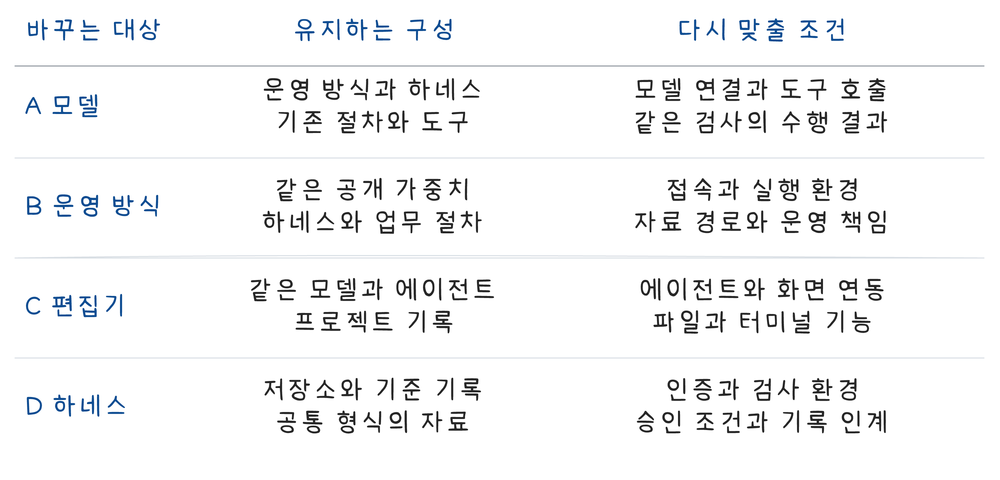
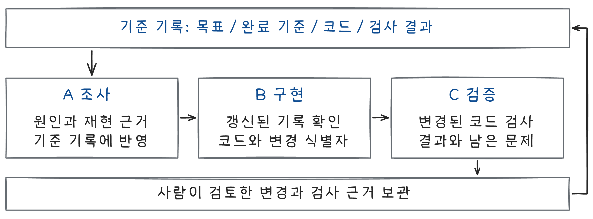
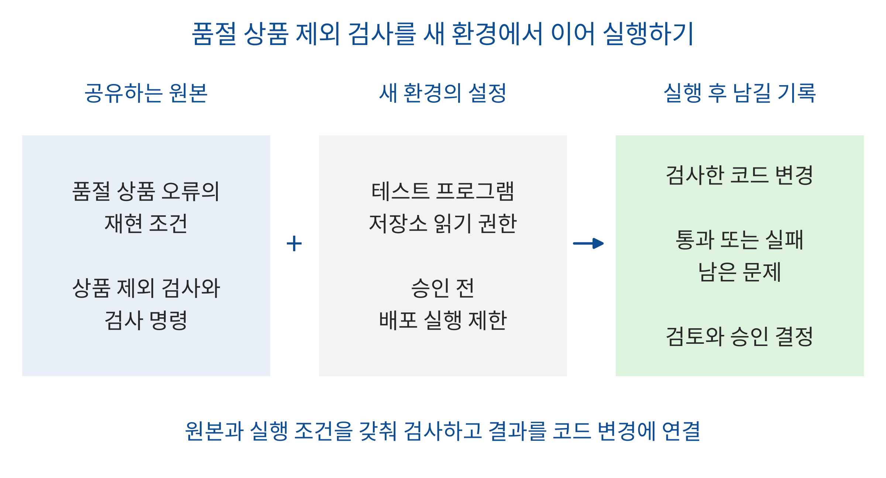
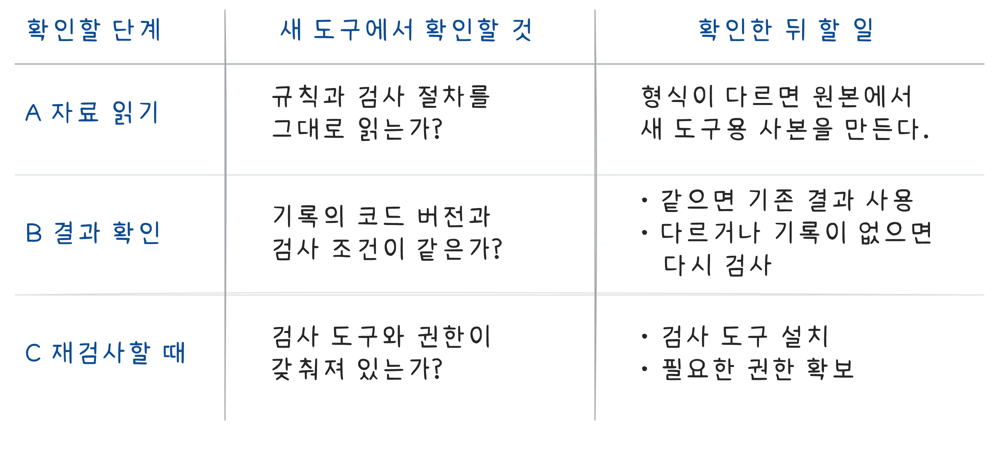

<!-- authoritative-lang: ko -->

# §17.4 하네스와 도구 프로토콜의 표준화 {.unnumbered}

```{=html}
<style>
.ch17-table-layout table th + th,
.ch17-table-layout table td + td { border-left: 1px solid #a6a6a6; }
.ch17-table-layout table th,
.ch17-table-layout table td { padding: 0.35em 0.5em; vertical-align: top; }
.ch17-table-layout table td { border-bottom: 0.5px solid #d9d9d9; }
</style>
```

:::: {.ch17-table-layout}

```{=typst}
#[
#set table(
  inset: (x: 4pt, y: 3pt),
  stroke: (x, y) => (
    left: if x > 0 { 0.45pt + luma(65%) } else { none },
    right: none,
    top: none,
    bottom: 0.25pt + luma(85%),
  ),
)
```

온라인 상점의 검색 기능을 개발하면서 조사에는 Claude Code를, 구현에는 Codex를 사용한다고 하자. 구현 담당 에이전트가 작업을 시작하려면 무엇을 고쳐야 하는지, 그리고 앞선 조사에서 무엇을 확인했는지 알아야 한다. 이 내용이 조사 도구의 대화에만 남아 있다면 개발자가 다시 정리해 전달해야 한다. 반면 프로젝트가 요구사항과 조사 결과를 관리하고 각 에이전트가 그 기록을 읽는다면, 같은 정보를 바탕으로 역할을 나누거나 도구를 바꿔 작업을 계속할 수 있다.

§17.1의 모델, §17.2의 운영 방식, §17.3의 사용 환경을 선택할 때에는 이렇게 선택을 바꿀 가능성도 고려해야 한다. 기존 구성을 나중에 옮기는 방법과 함께, 처음부터 프로젝트의 정보를 특정 도구와 분리해 관리하는 방법이 중요해진다. 공통 규격은 이 정보와 도구를 여러 하네스에 연결하는 데 드는 비용을 줄인다. 여러 에이전트를 관리하는 제품도 등장하면서, 어떤 정보를 공통으로 관리하고 무엇을 각 제품의 설정으로 남길지가 실제 개발 환경의 선택 기준이 되고 있다.

## 교체와 병용에서 유지할 프로젝트 자산 {.unnumbered}

도구를 바꾸는 비용은 바꾸려는 대상에 따라 달라진다. 모델만 교체하면 기존 하네스의 파일 편집과 검사 구성을 유지할 수 있다. 하네스까지 바꾸면 프로젝트 규칙과 절차, 외부 도구 접속 설정을 새 제품에서 사용할 수 있도록 준비해야 한다. 이러한 이전과 재검증에 드는 시간과 인력이 전환 비용이다. 프로젝트 규칙과 절차, 외부 도구 정보를 다른 하네스에서도 활용할 수 있는 정도를 이식성이라고 한다.

앞의 온라인 상점에서 품절 상품이 검색 결과에 표시되는 오류를 수정하는 상황을 가정해 보자. 에이전트가 검색 코드를 수정한 뒤, 품절 상품이 제외되는지 여부와 기존 검색 기능이 정상인지 자동 테스트로 확인한다. 사람은 변경과 검사 결과를 검토한 뒤 배포를 승인한다. 이 작업을 다른 하네스에 맡기려면 검사 명령뿐만 아니라 검사 대상 코드와 승인 조건도 함께 사용할 수 있어야 한다.

같은 하네스에서 모델을 선택하는 지원은 이미 제공되고 있다. OpenCode에서는 공급자와 모델을 등록하고, 직접 운영하는 모델도 호환 API와 접속 주소를 설정해 연결할 수 있다 [\[1\]](#ref-17-4-1). 이 경우 개발자가 확인할 것은 새 모델이 기존 도구를 사용해 동일한 편집과 검사를 수행하는지 여부다. 동일한 공개 가중치 모델을 서비스 이용에서 직접 운영으로 전환한다면 접속 방식과 운영 책임을 확인해야 한다. 편집기만 바꾸고 에이전트를 유지한다면 새 화면과 에이전트의 연결이 중요해진다.

이 구분은 여러 도구를 함께 사용할 때도 적용된다. 조사와 구현을 서로 다른 에이전트에 맡겨도 프로젝트의 요구사항과 완료 기준은 유지해야 한다. 규칙과 기록의 원본을 프로젝트가 관리하면, 각 도구에 따로 저장한 내용을 반복해서 옮기고 맞추는 부담을 줄일 수 있다. 하네스를 교체할 때에는 프로젝트 원본을 재사용하는 일과 실행 조건을 다시 준비하는 일을 나누어 확인한다(@fig-17-4-7).

::: {.content-visible when-format="html"}

{#fig-17-4-7 fig-alt="모델, 운영 방식, 편집기, 하네스를 바꾸는 네 경우를 행으로 나누고 유지하는 구성과 다시 맞출 조건을 대조한다."}

:::

::: {.content-visible when-format="typst"}

{#fig-17-4-7 fig-alt="모델, 운영 방식, 편집기, 하네스를 바꾸는 네 경우를 행으로 나누고 유지하는 구성과 다시 맞출 조건을 대조한다."}

:::

## 도구와 분리된 프로젝트 정보 관리 {.unnumbered}

프로젝트 정보를 도구와 분리해 관리하려면 각 정보의 기준 원본과 갱신 방법을 정해야 한다. 요구사항은 이슈에서, 코드는 저장소에서, 검사 결과는 자동 검사 기록에서 관리하는 식이다. 각 에이전트는 맡은 작업에 필요한 원본을 읽고, 확인된 결과를 해당 원본에 연결한다. 도구의 대화를 통째로 옮기는 대신 프로젝트 기록에서 다음 작업의 문맥을 구성하는 방식이다.

검색 오류 사례에서는 이슈에 ‘품절 상품을 결과에서 제외한다’는 목표와 수정 범위를 명시한다. 완료 기준에는 오류를 재현한 검색 경로와 기존 검색 기능의 검사 통과 조건을 기재한다. 조사 담당 에이전트는 재현 조건과 관련 코드, 원인에 대한 근거를 기록한다. 구현 담당은 이를 읽고 코드를 수정한 후 변경 사항을 식별할 수 있는 커밋이나 패치를 연결한다. 검증 담당은 해당 코드 상태에서 실행한 검사와 그 결과를 기록하고, 남은 문제를 남긴다. 사람이 변경을 받아들이면 승인한 대상과 그 이유를 기록한다. 다음은 이 가상 구성에서 관리할 정보의 예시이다.

| 관리할 정보 | 기준 원본의 예 | 다른 에이전트가 확인할 내용 |
|---|---|---|
| 요구사항과 완료 기준 | 프로젝트 이슈와 문서 | 해결할 오류, 수정 범위, 성공 조건 |
| 설계 결정과 작업 규칙 | 버전 관리되는 문서와 규칙 파일 | 결정 이유, 적용 범위, 지켜야 할 제약 |
| 반복 절차 | 스크립트, 테스트 명령, 스킬 | 오류 재현 방법과 검증 순서 |
| 변경과 검사 근거 | 커밋이나 패치에 연결된 검사 기록 | 어느 코드에서 무엇을 검사했는지 |
| 진행 상태 | 작업별 인계 기록 | 끝난 일, 실패한 시도, 남은 문제 |

원본의 형식과 정보 간의 연결도 함께 정해야 한다. ‘완료’라고만 기록하면 다음 에이전트가 어떤 조건을 충족했는지 판단하기 어렵다. 완료 기준과 변경 식별자, 검사 결과를 연결하면 같은 코드를 다시 조사할지, 구현을 이어갈지 결정할 근거가 생긴다. 작업 공간과 권한의 분리는 §17.3의 원칙을 따르되, 공통 기록에는 각 결과가 어느 작업 공간과 코드 상태에서 나왔는지 기록한다.

이 구성에서 도구 독립성은 다른 에이전트도 프로젝트 기록을 읽고 후속 작업을 시작할 수 있는 정도를 의미한다. 조사 결과를 기준 원본에 반영한 뒤, 구현 담당이 그 기록을 읽고 검증 담당은 변경된 코드를 기준으로 검사한다(@fig-17-4-9). 담당이 바뀔 때마다 원본을 갱신하되, 조사 중인 추정과 채택된 결정을 구분하고 사람이 검토한 결과를 남긴다. 다음 담당자는 이를 바탕으로 어떤 작업을 이어받았는지 확인한다.

::: {.content-visible when-format="html"}

{#fig-17-4-9 fig-alt="프로젝트가 관리하는 기준 기록을 바탕으로 A 조사, B 구현, C 검증을 순서대로 진행한다. 담당이 바뀔 때 기록을 갱신하고 확인한다. 사람이 검토한 변경과 검사 근거는 기준 기록으로 돌아간다."}

:::

::: {.content-visible when-format="typst"}

{#fig-17-4-9 fig-alt="프로젝트가 관리하는 기준 기록을 바탕으로 A 조사, B 구현, C 검증을 순서대로 진행한다. 담당이 바뀔 때 기록을 갱신하고 확인한다. 사람이 검토한 변경과 검사 근거는 기준 기록으로 돌아간다."}

:::

## 여러 에이전트의 실행과 작업 인계 {.unnumbered}

프로젝트 기록을 함께 사용하려면 작업을 배분하고, 필요한 자료를 전달하며, 실행 결과를 모으는 관리 기능이 필요하다. 이 과정을 조율하는 도구가 오케스트레이터다. 여기서는 작업의 원본을 프로젝트에 남기는 방법과 각 에이전트의 실행을 관리하는 기능이 어떻게 연결되는지 구분해야 한다.

먼저 작업의 목표와 개별 실행을 분리할 수 있다. 검색 오류 조사가 중단되거나 구현 담당자가 바뀌더라도 ‘품절 상품을 제외한다’는 목표와 완료 기준은 유지되어야 한다. Orca의 실험적 작업 조율 기능은 목표와 상태를 가진 작업(Task)과 개별 실행 시도(Dispatch)를 구분한다 [\[2\]](#ref-17-4-2). 작업 공간은 일반 Git worktree이므로 코드 변경을 Orca 밖에서도 Git으로 확인할 수 있다 [\[3\]](#ref-17-4-3). 이 구성에서 프로젝트가 확보할 원본은 작업 목표와 코드 변경, 검사 결과를 연결한 기록이다. 이를 프로젝트 이슈와 저장소에 남겨 두면 관리 도구를 바꿀 때에도 새 실행에 필요한 근거를 확인할 수 있다.

여러 에이전트가 사용할 절차와 접속 설정도 한 곳에서 준비할 수 있다. Emdash Classic의 Library는 프롬프트와 스킬, MCP 서버 설정을 관리하고 지원 에이전트에 서버 설정을 동기화한다. 원격 머신의 설정은 해당 머신에서 별도로 관리한다 [\[4\]](#ref-17-4-4). 검색 오류 재현 절차와 저장소 조회 서버를 공통으로 준비하면, 조사와 구현에 다른 에이전트를 사용하더라도 중복 설정이 줄어든다. 관리 도구까지 교체할 때는 배포한 스킬 본문과 서버 설정의 원본을 확보하고, 새 도구에서 동일한 자료를 읽을 수 있는지 확인해야 한다.

담당이 바뀌는 시점에는 공통 자료 중 다음 작업에 필요한 부분을 선별해 전달한다. Paseo는 Claude로 계획한 작업을 Codex에 구현하도록 넘기는 예를 제시한다 [\[5\]](#ref-17-4-5). 인계 스킬은 받는 에이전트가 이전 문맥 없이 시작한다고 전제하고, 목표와 관련 파일, 진행 상태, 실패한 시도와 완료 기준 등을 정리해 전달한다 [\[6\]](#ref-17-4-6). 검색 오류 사례라면 어떤 원인을 확인했고, 어느 코드까지 수정했으며, 어떤 검사가 남았는지를 프로젝트 기록의 위치와 함께 전달한다. 다음 담당자는 원본을 확인해 인계 내용을 보완할 수 있다.

이처럼 작업 배분과 설정 공유, 문맥 전달은 개별 에이전트를 변경해야 하는 부담을 줄인다. 관리 도구를 바꿀 때에도 유지할 것은 코드와 절차의 원본, 작업과 결과 간의 연결을 반드시 유지해야 한다.제품 선택 시에는 실행 관리의 편의성과 더불어 기록을 읽고 타 환경에서 활용할 수 있는 방안을 검토해야 한다.

## 공통 기록과 절차를 여러 도구에 연결하기 {.unnumbered}

같은 프로젝트 기록을 활용하려면 각 하네스가 규칙과 절차를 읽고 필요한 자료에 접근할 수 있어야 한다. 공통 규격은 제품마다 연결을 새로 준비해야 하는 부담을 줄여준다. 검색 오류 사례는 프로젝트 안내와 재현 절차를 공유하는 일, 저장소와 검사 기록을 조회하는 일, 지시와 결과 확인에 사용하는 화면을 변경하는 일로 나누어 볼 수 있다.

프로젝트의 수정 범위와 검증 방법을 `AGENTS.md`에 연결하고, 반복되는 재현 및 검사 절차를 Agent Skills 형식으로 관리하면 지원 하네스에서 동일한 원본을 참조할 수 있다 [\[7\]](#ref-17-4-7)[\[8\]](#ref-17-4-8). 이때 새 하네스가 파일 검색 경로, 규칙 적용 범위, 절차 실행에 필요한 프로그램과 권한을 올바르게 인식하는지 확인해야 한다. 규칙과 스킬을 수정할 경우 원본 버전을 갱신하고, 각 하네스가 해당 버전을 참조하는지 점검한다.

이슈나 검사 기록을 외부 서비스에서 관리하는 경우, 해당 자료에 접근할 수 있는 연결이 필요하다. 예를 들어 작업 저장소를 MCP 서버로 제공하는 구성에서는 지원 하네스가 동일한 서버를 통해 기록을 조회할 수 있다. 결과를 모델에 전달하고 작업에 활용하는 방식은 하네스가 결정한다 [\[9\]](#ref-17-4-9). 새 하네스에서는 서버 접속 주소, 실행 명령, 인증 및 접근 권한을 확인하고 동일한 기록이 조회되는지 점검해야 한다.

절차와 외부 연결을 함께 전달할 때는 Agent Plugins 형식을 활용한다. Agent Plugins 1.0.0은 스킬과 MCP 서버 정보를 하나의 패키지로 통합한다 [\[10\]](#ref-17-4-10). 이로써 검색 오류 수정 절차와 저장소 조회 서버의 접속 정보를 함께 배포할 수 있다. VS Code의 공통 형식 지원은 이러한 스킬과 서버의 재사용 사례이며, 자동 검사 명령 실행 훅은 제품별 기능으로 구분된다 [\[11\]](#ref-17-4-11). 패키지의 원본을 유지하면서 각 제품의 실행 설정을 조정하는 방식이다.

프로젝트 기록과 에이전트를 유지한 채 작업 화면만 변경하는 것도 가능하다. ACP는 편집기와 에이전트 간 통신을 표준화하며 [\[12\]](#ref-17-4-12), Zed는 이를 활용해 OpenCode 등 외부 에이전트를 연결한다 [\[13\]](#ref-17-4-13). 이 경우 기존 에이전트가 사용하는 자료와 실행 구성을 유지하고, 새로운 화면에서 작업 지시 및 결과 확인이 가능한지 점검해야 한다.

| 규격과 형식 | 현재 규격으로 공유하는 대상 | 새 환경에서 맞출 조건 |
|---|---|---|
| AGENTS.md | 프로젝트 안내와 작업 규칙 | 파일 검색 경로, 적용 범위와 지시 우선순위 |
| Agent Skills | 절차 본문과 스크립트, 참고 자료 | 필요한 프로그램과 실행 권한 |
| MCP | 외부 자료와 도구를 조회하고 호출하는 방식 | 지원 기능, 인증과 자료 접근 권한 |
| Agent Plugins | 스킬과 MCP 서버 정보를 담은 묶음 | 제품 고유 확장과 실행 설정 |
| ACP | 편집기와 에이전트 사이의 통신 | 양쪽의 지원 기능과 연결 방식 |

이러한 연결을 준비하면 동일한 프로젝트 자료를 여러 하네스에서 활용할 수 있다. 이후 각 하네스의 실행이 프로젝트의 검사 및 승인 조건을 준수하는지, 작업 완료 후 결과를 원본 기록에 연결해 남기는지 확인해야 한다.

## 실행 설정과 작업 기록에 남는 제품 의존성 {.unnumbered}

프로젝트 자료를 이어 쓸 수 있어도 실제 실행 조건은 새로운 환경에서 반드시 확인해야 한다. 검색 오류 수정 절차와 검사 명령이 동일하더라도 저장소 인증, 실행 환경, 승인 설정은 제품별로 상이하다. 기존에 사람이 승인하기 전 배포가 제한되었다면, 새 하네스에서도 동일한 조건이 적용되는지 검증해야 한다.

예를 들어, 품절 상품 제외 검사를 새로운 하네스에서 실행한다고 하자. 프로젝트가 제공하는 것은 오류 재현 조건과 상품 제외 검사, 검사 명령이다(@fig-17-4-8). 새로운 환경에는 테스트 프로그램과 저장소 읽기 권한, 승인 전 배포 제한 설정을 준비해야 한다. 실행 후에는 검사한 코드 변경 사항과 통과 또는 실패 결과, 남은 문제를 연결하여 기록한다. 변경 사항을 사람이 검토할 경우 승인 대상과 결정도 함께 기록한다.

::: {.content-visible when-format="html"}

{#fig-17-4-8 fig-alt="품절 상품 오류의 재현 조건과 검사 명령에 새 환경의 테스트 프로그램, 저장소 읽기 권한, 승인 전 배포 제한을 더한다. 실행 뒤에는 검사한 코드와 통과 또는 실패, 남은 일과 승인 결정을 연결한다."}

:::

::: {.content-visible when-format="typst"}

{#fig-17-4-8 fig-alt="품절 상품 오류의 재현 조건과 검사 명령에 새 환경의 테스트 프로그램, 저장소 읽기 권한, 승인 전 배포 제한을 더한다. 실행 뒤에는 검사한 코드와 통과 또는 실패, 남은 일과 승인 결정을 연결한다."}

:::

특정 실행 기능에 의존하는 구성은 해당 기능을 대체할 작업이 필요하다. 예를 들어 MCP 서버를 코드에서 호출하고 반환 데이터를 가공하여 필요한 결과만 모델에 전달하는 설계가 있다 [\[14\]](#ref-17-4-14). 검색 오류 조사에 이 방식을 적용했다면, 재사용 자료에는 서버 정보와 조회 및 가공 코드가 포함된다. 새로운 환경에서는 해당 코드를 실행할 프로그램, 권한, 가공 결과를 모델에 전달할 경로를 준비해야 한다. 이처럼 프로젝트가 보관하는 원본과 실행 환경에서 조정해야 할 부분을 구분하면 이전 범위를 명확히 파악할 수 있다.

진행 중인 작업에서는 세션 복원과 문맥 인계를 명확히 구분해야 한다. ACP v1의 세션 불러오기는 지원 에이전트가 자신의 대화 이력을 클라이언트에 전달하는 기능이다 [\[15\]](#ref-17-4-15). Orca의 세션 이력 기능 역시 해당 에이전트가 남긴 기록을 읽고 재개 명령을 실행한다 [\[16\]](#ref-17-4-16). 동일 에이전트의 작업을 다시 열 때는 이러한 복원 기능을 활용한다. 다른 에이전트에 작업을 인계할 경우, Paseo 사례처럼 프로젝트 원본을 기반으로 목표, 코드 상태, 검사 결과, 남은 일을 구성해 전달하고, 다음 담당자가 그 근거를 확인할 수 있도록 한다.

관리 도구의 기록 확보 방법도 반드시 확인해야 한다. Emdash는 앱 상태를 로컬 SQLite 데이터베이스에 저장한다고 명시한다 [\[17\]](#ref-17-4-17). 다른 도구로 이전할 때는 저장된 작업, 코드 변경, 검사 결과, 승인 결정을 읽고 상호 연결할 수 있는 방법이 필요하다. 검색 오류 수정 작업을 내보낸 경우, 다음 담당자가 어떤 변경을 검토했고 무엇이 승인되었는지 재구성할 수 있어야 한다. 이러한 연결이 유지되는지 확인함으로써 기록 이동의 범위를 판단할 수 있다.

::: {.callout-note}
## 계정 접근이 중단될 때의 작업 기록

작업 기록을 서비스 계정에만 저장할 경우, 접근이 중단되면 후속 작업의 근거 확보가 어렵다. OpenAI의 개인용 서비스 약관 역시 이용 정지 및 종료 가능성을 명시한다 [\[18\]](#ref-17-4-18). 작업 목표, 채택된 결정, 코드 변경, 검사 결과를 프로젝트가 관리하는 기록에 남겨 두면 다음 에이전트에 전달할 원본을 확보할 수 있다.

:::

앞서 제시한 사례들은 작업과 실행의 구분, 공통 설정 전달, 문맥 인계를 지원한다. 이를 여러 제품에서 연속적으로 활용하려면 프로젝트 기록의 내용뿐 아니라 관계 역시 보존해야 한다. 예를 들어 검사 결과가 어느 커밋과 수정 내역에 해당하는지, 남은 문제가 어떤 완료 기준과 연결되는지 새 도구에서 확인할 수 있어야 한다. 이러한 관계를 내보내고 다시 읽어 검증하는 지원이 확대될수록 관리 도구 교체 부담이 감소한다.

## 표준화와 개발자의 선택권 {.unnumbered}

현재의 공통 규격은 규칙, 절차, 외부 자료 접근 연결의 재사용 기반을 제공한다. 향후 프로젝트 정보를 더 다양한 제품 조합에서 활용하려면 변경 식별자, 검사 결과, 미완료 항목 간의 연결 보존 방법이 중요하다. 검색 오류 작업을 맡길 도구를 변경하더라도 동일한 근거로 후속 작업을 시작할 수 있어야 한다.

이러한 과제를 공통 규격으로 다루려면 채택할 항목과 기능에 대한 합의가 필요하며, 각 제품에 이를 구현해야 한다. MCP에서는 핵심 유지관리자가 규격 방향과 제안을 검토하고, 수석 유지관리자가 최종 결정을 내린다 [\[19\]](#ref-17-4-19). 여러 규격에 걸친 협력 기반으로는 MCP와 AGENTS.md 등을 초기 기여 프로젝트로 받은 Linux Foundation 산하 Agentic AI Foundation(AAIF)이 있다 [\[20\]](#ref-17-4-20). AAIF 기술위원회는 프로젝트 간 협력과 공통 기술 우선순위를 조정한다 [\[21\]](#ref-17-4-21). 본 절에서 제시한 기록 이동 과제를 평가할 때에도 논의 주체와 실제 채택 형식, 제품의 지원 범위를 함께 확인해야 한다.

지원 규격을 확인한 후에는 해당 도구를 실제로 확보하고 사용할 수 있는지 점검해야 한다. MCP Registry는 서버 설명, 설치 위치, 원격 접속 주소 등을 공유하며, 이를 활용하는 검색 서비스는 자체 분류 및 심사 방식을 적용할 수 있다. Registry는 현재 preview 단계다 [\[22\]](#ref-17-4-22). JetBrains AI Assistant에서도 조직 중앙 관리자가 사용할 ACP 에이전트와 별도 에이전트 추가 허용 여부를 제한할 수 있다 [\[23\]](#ref-17-4-23). 프로젝트 기록을 읽을 수 있는 규격을 지원하더라도, 필요한 도구 설치와 자료 접근 권한은 도입 환경에서 별도로 확보해야 한다.

공통 형식, 제품 구현, 도입 조건은 각각 별도의 추가 작업을 요구한다(@fig-17-4-3). 공통 형식이 부족할 경우 원본 변환이 필요하며, 제품이 검사 근거의 연결을 보존하지 못하면 검사한 코드를 재확인해야 한다. 도구 설치와 자료 접근 권한은 기록을 활용해 실제 검사를 실행하기 위한 필수 조건이다.

::: {.content-visible when-format="html"}

{#fig-17-4-3 fig-alt="공통 형식이 부족하면 원본 변환이 필요하다. 제품이 변경과 검사 기록의 연결을 내보내지 못하면 대상 코드를 재확인한다. 도구 설치와 자료 접근 권한이 부족하면 실행 조건부터 확보한다."}

:::

::: {.content-visible when-format="typst"}

{#fig-17-4-3 fig-alt="공통 형식이 부족하면 원본 변환이 필요하다. 제품이 변경과 검사 기록의 연결을 내보내지 못하면 대상 코드를 재확인한다. 도구 설치와 자료 접근 권한이 부족하면 실행 조건부터 확보한다."}

:::

이러한 지원이 확대되면 개발자는 프로젝트 원본을 유지하면서 작업별로 다양한 모델과 에이전트를 비교할 수 있다. 제품 평가 시 실행 품질뿐 아니라 기록을 읽고, 내보내고, 재활용하는 기능도 중요하다. 검색 오류의 목표, 변경, 검사 및 승인 기록이 남아 있다면 다음 도구를 시험할 때 동일한 근거에서 시작할 수 있다.

§17.1의 모델 성능, §17.2의 운영 자율성, §17.3의 개발 환경을 선택할 때에는 이처럼 이후 선택을 변경할 수 있는 조건도 함께 고려해야 한다. 현재 에이전트나 관리 도구를 사용할 수 없게 됐을 때에도 프로젝트의 목표와 결정, 변경과 검사 결과를 읽고 다음 작업을 시작할 수 있는지가 그 기준이 된다.

::: {.callout-tip}
## 환경 및 도구 선택 변경 전 핵심 점검 항목

* 요구사항과 완료 기준, 설계 결정의 원본을 어느 프로젝트 기록에서 관리하는가?
* 모델, 하네스, 편집기 중 무엇을 바꾸고, 어떤 자료와 설정을 유지하는가?
* 각 에이전트가 기준 기록을 읽고, 변경 식별자와 검사 결과를 연결해 남길 수 있는가?
* 공통 설정과 제품별 실행 권한, 훅과 승인 조건을 구분해 준비했는가?
* 현재 에이전트나 관리 도구 없이도 기록을 읽고 후속 작업을 시작할 수 있는가?

:::

::: {.callout-note collapse="true"}
## 토론 질문

* 여러 에이전트를 병용할 때, 프로젝트의 기준 원본과 각 도구의 세션에는 어떤 정보를 남겨야 할까?
* 공통 자료를 지원하는 기능과 실행 및 인계 지원은 각각 어떻게 확인할 수 있을까?
* 규격과 관리 도구, 도구 검색 서비스의 결정은 개발자의 선택권에 어떤 영향을 미칠까?

:::

```{=typst}
]
```

::::

## 참고 자료 {.unnumbered}

::: {#ref-17-4-1}
[1] [OpenCode, Providers](https://opencode.ai/docs/providers/). (확인: 2026-11-16; 제품: OpenCode; 공급자 연결 문서의 적용 제품 버전은 별도로 표시되지 않음; 관련 항목: Custom, Endpoint, Ollama).
:::

::: {#ref-17-4-2}
[2] [Orca, Orchestration](https://orca.dev/docs/cli/orchestration). (확인: 2026-11-16; 제품: Orca; 실험 기능; 조율 화면과 스위치의 일시적 비활성화 안내; Task와 Dispatch 구분).
:::

::: {#ref-17-4-3}
[3] [Orca, Worktrees](https://orca.dev/docs/model/worktrees). (확인: 2026-11-16; 제품: Orca; 제품 버전 별도 미표시; 일반 Git worktree와 외부 Git 접근).
:::

::: {#ref-17-4-4}
[4] [Emdash, Library](https://emdash.com/docs/library). (확인: 2026-11-16; 제품: Emdash Classic; Library의 프롬프트, 스킬, MCP 설정 관리와 원격 머신별 범위).
:::

::: {#ref-17-4-5}
[5] [Paseo, README](https://github.com/getpaseo/paseo). (확인: 2026-11-16; 제품: Paseo; main의 README; Claude에서 계획하고 Codex에 구현을 인계하는 예).
:::

::: {#ref-17-4-6}
[6] [Paseo, Handoff Skill](https://github.com/getpaseo/paseo/blob/main/skills/paseo-handoff/SKILL.md). (확인: 2026-11-16; main의 스킬 원문; 받는 에이전트의 문맥, 진행 상태, 실패한 시도와 완료 기준 구성).
:::

::: {#ref-17-4-7}
[7] [AGENTS.md, AGENTS.md](https://agents.md/). (확인: 2026-11-16; 형식의 별도 버전 번호 미표시; How to use AGENTS.md, What if instructions conflict).
:::

::: {#ref-17-4-8}
[8] [Agent Skills, Specification](https://agentskills.io/specification). (확인: 2026-11-16; 명세의 별도 버전 번호 미표시; 관련 항목: compatibility, allowed-tools, Progressive disclosure).
:::

::: {#ref-17-4-9}
[9] [Model Context Protocol, Architecture overview](https://modelcontextprotocol.io/docs/2026-07-28/learn/architecture). (확인: 2026-11-16; 규격 버전: 2026-07-28; 관련 항목: Scope, Data Layer Protocol, Understanding the Discovery Exchange).
:::

::: {#ref-17-4-10}
[10] [Agent Plugins, Agent Plugins Specification](https://agent-plugins.org/specification). (확인: 2026-11-16; 규격 버전: 1.0.0 공개판; 관련 조항: §4, §7, §8, §11).
:::

::: {#ref-17-4-11}
[11] [Microsoft, Agent plugins in VS Code](https://code.visualstudio.com/docs/agent-customization/agent-plugins). (확인: 2026-11-16; 제품: Visual Studio Code; 문서의 대상 제품 버전 별도 미표시; 관련 항목: What plugins provide, Cross-tool compatibility).
:::

::: {#ref-17-4-12}
[12] [Agent Client Protocol, Introduction](https://agentclientprotocol.com/get-started/introduction). (확인: 2026-11-16; 규격: ACP; 공식 문서의 최신 공개 프로토콜은 v1, v2는 초안; 원격 에이전트의 완전한 지원은 진행 중).
:::

::: {#ref-17-4-13}
[13] [Zed Industries, External Agents](https://zed.dev/docs/ai/external-agents). (확인: 2026-11-16; 제품: Zed; 문서의 대상 제품 버전 별도 미표시; 관련 항목: External Agents, Gemini CLI, OpenCode).
:::

::: {#ref-17-4-14}
[14] [Anthropic, Code execution with MCP: Building more efficient agents](https://www.anthropic.com/research/code-execution-with-mcp). (확인: 2026-11-16; 2025-11-04 게시; MCP와 코드 실행을 결합하는 설계 사례).
:::

::: {#ref-17-4-15}
[15] [Agent Client Protocol, Session Setup](https://agentclientprotocol.com/protocol/v1/session-setup). (확인: 2026-11-16; 규격 버전: ACP v1; 관련 항목: Loading sessions).
:::

::: {#ref-17-4-16}
[16] [Orca, Agent session history](https://orca.dev/docs/agents/session-history). (확인: 2026-11-16; 제품: Orca; 제품 버전 별도 미표시; 에이전트별 기록 검색과 해당 에이전트의 재개 명령).
:::

::: {#ref-17-4-17}
[17] [Emdash, README](https://github.com/generalaction/emdash). (확인: 2026-11-16; main의 README; Privacy 항목의 로컬 SQLite 상태 보관).
:::

::: {#ref-17-4-18}
[18] [OpenAI, Terms of Use](https://openai.com/policies/terms-of-use/). (확인: 2026-11-16; 개인용 서비스 약관, 2026-01-01 발효본; 관련 항목: Using our Services, Termination and suspension).
:::

::: {#ref-17-4-19}
[19] [Model Context Protocol, Governance and Stewardship](https://modelcontextprotocol.io/community/governance). (확인: 2026-11-16; 프로젝트 운영 문서; 문서 버전 별도 미표시; 관련 항목: Technical Governance, Roles, Decision Process).
:::

::: {#ref-17-4-20}
[20] [Agentic AI Foundation, Linux Foundation Announces the Formation of the Agentic AI Foundation (AAIF), Anchored by New Project Contributions Including Model Context Protocol (MCP), goose and AGENTS.md](https://aaif.io/news/linux-foundation-announces-formation-of-aaif). (확인: 2026-11-16; 2025-12-09 발표; AAIF의 설립과 초기 기여 프로젝트에 관한 발표).
:::

::: {#ref-17-4-21}
[21] [Agentic AI Foundation, Charter for the Technical Committee of the Agentic AI Foundation](https://github.com/aaif/technical-committee/blob/main/governance/charter.md). (확인: 2026-11-16; 2026-03-03 채택본; 관련 조항: §1, §2; 프로젝트 간 협력 조정 및 운영이사회에 대한 권고).
:::

::: {#ref-17-4-22}
[22] [Model Context Protocol, The MCP Registry](https://modelcontextprotocol.io/registry/about). (확인: 2026-11-16; 상태: preview; 서비스 버전 별도 미공개; 관련 항목: Relationship with Package Registries, Relationship with Downstream Aggregators).
:::

::: {#ref-17-4-23}
[23] [JetBrains, Agent Client Protocol (ACP)](https://www.jetbrains.com/help/ai-assistant/acp.html). (확인: 2026-11-16; 문서: AI Assistant 2026.3 Help; 관련 항목: ACP 지원, 중앙 관리 시 에이전트 제한; 문서상 WSL에서는 ACP 에이전트 미지원).
:::
