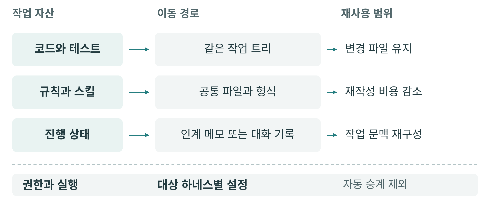
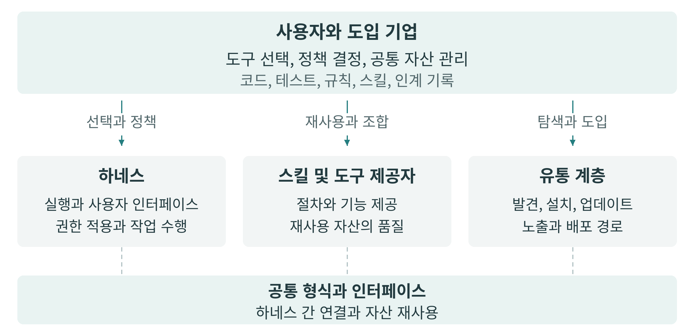

<!-- authoritative-lang: ko -->

# §17.4 하네스와 도구 프로토콜의 표준화 {.unnumbered}

## 도구를 바꿀 때 옮겨야 할 것 {.unnumbered}

AI 코딩 도구를 쓰다 보면 코드 외에도 프로젝트 규칙, 반복해서 쓸 개발 절차, 외부 서비스 연결 설정, 작업 중 내린 판단과 그 기록이 쌓인다. 다른 도구를 시험하려면 이 가운데 무엇을 가져갈 수 있고 무엇을 다시 준비해야 하는지 알아야 한다. 이식성은 이런 자산을 다른 환경에서도 이어 사용할 수 있는 정도를 뜻한다.

이식성에는 모델을 둘러싼 하네스도 영향을 준다. 하네스는 모델에 작업 정보를 전달하고 도구를 실행하며, 기록과 권한을 관리하는 실행 환경이다. 코딩 도구인 Codex에서 하던 작업을 Claude Code로 옮긴다고 하자. 같은 코드 저장소를 열어도 이전에 내린 결정이나 남은 작업까지 새 도구가 아는 것은 아니다. §17.3에서 다룬 작업 기록과 권한을 도구 전환 과정에서도 확인해야 하는 이유다.

규칙과 절차를 특정 제품에서만 쓸 수 있는 형태로 쌓으면 도구를 바꾸는 부담이 커진다. 공통 형식과 연결 규약은 자산을 다시 작성하는 일을 줄이고, 개인과 조직이 여러 하네스를 비교하거나 교체할 여지를 만든다. 다만 형식이 같아도 실제 지원 기능과 실행 방식은 제품마다 확인해야 한다.

## 자산별 공통 형식과 연결 규약 {.unnumbered}

프로젝트 지시를 담는 `AGENTS.md`는 에이전트가 저장소에서 알아야 할 규칙을 일정한 위치에 두는 공개 형식이다. 반복해서 사용할 작업 절차를 묶은 스킬은 Agent Skills 형식에 따라 `SKILL.md`와 필요한 스크립트, 참조 자료로 구성할 수 있다. 외부 도구나 자료에 접근할 때 쓰는 MCP(Model Context Protocol)는 AI 애플리케이션과 도구를 제공하는 프로그램 사이의 통신을 정한다. 프로젝트 규칙, 작업 절차, 외부 도구 연결은 각각 다른 대상으로 표준화되는 셈이다 [\[1\]](#ref-17-4-1)[\[2\]](#ref-17-4-2)[\[3\]](#ref-17-4-3).

편집기와 코딩 에이전트를 연결하는 규약도 있다. 양쪽 제품이 호환되는 Agent Client Protocol(ACP) 구현을 제공하면, 사용자는 익숙한 편집기를 유지하면서 에이전트를 바꿔 쓸 수 있다. MCP가 외부 도구와 자료에 대한 연결을 맡는 데 비해 ACP는 편집기와 에이전트 사이의 통신을 다룬다 [\[4\]](#ref-17-4-4)[\[3\]](#ref-17-4-3). 확인한 ACP v1 명세는 같은 컴퓨터에서 두 프로그램을 연결하는 방식을 정의하며, 원격 연결을 위한 공통 방식은 설계 중이다. 원격 환경에서는 선택한 제품이 제공하는 연결 방법을 따로 확인해야 한다 [\[5\]](#ref-17-4-5).

공통 형식을 읽을 수 있어도 이전 작업의 기록과 권한 설정이 모두 이어지는 것은 아니다. Agent Skills 명세는 필요한 실행 환경과 도구를 적을 수 있게 하지만, 도구 허용에 관한 항목은 실험적이므로 제품별 지원 범위를 확인해야 한다 [\[2\]](#ref-17-4-2). 스킬을 옮긴 뒤에는 필요한 도구가 연결되어 있는지, 실행 권한이 주어졌는지도 살펴야 한다.

::: {.content-visible when-format="html"}

{#fig-17-4-1 fig-alt="코드와 테스트는 같은 작업 폴더로, 규칙과 스킬은 공통 파일로, 진행 상태는 인계 기록으로 옮기며 권한과 실행 설정은 대상별로 연결한다."}

:::

::: {.content-visible when-format="typst"}

{#fig-17-4-1 fig-alt="코드와 테스트는 같은 작업 폴더로, 규칙과 스킬은 공통 파일로, 진행 상태는 인계 기록으로 옮기며 권한과 실행 설정은 대상별로 연결한다."}

:::

그림의 ‘작업 트리’는 실제 코드와 테스트 파일이 있는 작업 폴더다. 파일, 규칙과 절차, 진행 상태는 각기 다른 경로로 이어진다. 권한과 실행 설정은 대상 하네스에서 다시 확인할 부분으로 남는다.

## Codex와 Claude Code 사이의 작업 인계 {.unnumbered}

상품 목록이 있는 웹 애플리케이션을 생각해 보자. 전체 상품의 3페이지를 보다가 상품 수가 적은 카테고리를 선택하면 빈 목록이 나온다. 카테고리가 바뀌어도 페이지 번호가 3으로 남아 있기 때문이다. 수정 목표는 카테고리를 바꿀 때 첫 페이지를 보여주는 것이며, 페이지당 상품 수는 유지해야 한다. 개발자가 Codex로 테스트를 준비하고 Claude Code에 수정을 맡긴 뒤, 다시 Codex로 검토한다고 하자. 도구 사이에서 무엇을 넘겨야 하는지 설명하기 위한 가상 사례이며, 아래의 가져오기 기능을 지원하는 환경을 가정한다.

Codex가 문제를 재현하는 테스트를 추가했지만 실제 동작은 아직 고치지 않은 시점에서 작업을 넘긴다. 이 테스트는 수정 뒤 같은 문제가 다시 발생하지 않는지 확인하는 회귀 테스트로도 쓰인다. 개발자는 코드와 테스트를 같은 작업 폴더에 유지하고, 인계 메모에는 다음과 같이 적을 수 있다.

> 카테고리 변경 뒤 첫 페이지를 보여주는지 확인하는 테스트를 추가했다. 실제 동작은 아직 수정하지 않았다. 페이지당 상품 수는 유지한다. 수정 후 새 테스트와 기존 페이지 이동 테스트를 실행하고 결과를 기록한다.

다른 컴퓨터로 작업을 옮긴다면 코드와 테스트의 변경 사항도 전달해야 한다. 대화 기록을 보내는 기능이 파일까지 옮겨 주지는 않는다.

작업 상태와 별도로 기존 설정을 가져오는 기능도 있다. Claude Code는 Codex의 지시 파일과 스킬 등 지원하는 설정을 가져오고, 적용 전에 바뀔 내용을 확인하는 기능을 제공한다. 제공 여부는 Claude Code 배포 환경에 따라 달라진다 [\[6\]](#ref-17-4-6). 지시 파일의 내용은 Claude Code의 프로젝트 지시 파일인 `CLAUDE.md`에 한 번 복사된다 [\[7\]](#ref-17-4-7). 이 기능으로 현재 버그의 진행 상태가 자동 전달되지는 않으므로 앞서 준비한 메모와 파일 변경이 필요하다.

두 하네스를 계속 병행한다면 복사 이후의 규칙 관리도 정해야 한다. `CLAUDE.md`에서 공통 원본인 `AGENTS.md`를 불러오게 구성하면 같은 규칙을 두 곳에서 따로 수정하는 일을 줄일 수 있다 [\[7\]](#ref-17-4-7).

Claude Code가 수정을 마치면 OpenAI가 제공하는 Claude Code용 Codex 플러그인으로 대화 기록을 전달할 수 있다. 기록 가져오기를 지원하는 Codex 환경이 필요하며, 플러그인은 가져온 기록을 열어 작업할 방법을 안내한다 [\[8\]](#ref-17-4-8). Codex 0.164.0에서 확인한 구현은 해당 Claude Code 대화를 처음 가져올 때 새 Codex 대화를 만든다. 이 사례의 최종 검토도 Claude Code의 기록을 받은 새 대화에서 시작한다 [\[9\]](#ref-17-4-9).

전달되는 기록에는 대화와 함께 사용한 도구, 그 결과에 대한 설명이 들어간다. 변환 과정에서 결과가 축약되거나 일부 기록이 빠질 수 있으며, 과거 테스트 결과를 가져와도 테스트가 다시 실행되지는 않는다 [\[10\]](#ref-17-4-10). 검토를 맡은 Codex는 현재 코드와 실행 환경을 확인하고 테스트를 다시 실행한다. 개발자는 그 결과와 남은 문제를 보고 변경을 받아들일지 판단한다.

작업을 넘길 때 필요한 정보는 다음과 같이 정리할 수 있다.

| 단계 | 맡는 도구 | 해야 할 일과 남길 기록 |
|---|---|---|
| 테스트 준비 | Codex | 문제를 재현하는 테스트와 수정 조건을 남긴다. |
| 구현 | Claude Code | 실제 동작을 고치고 변경 이유와 테스트 결과를 남긴다. |
| 최종 검토 | Codex | 현재 코드와 환경에서 다시 검사하고 남은 문제를 보고한다. |

## 공통 절차의 배포와 제품별 실행 {.unnumbered}

Superpowers는 계획 작성, 테스트 주도 개발, 코드 리뷰 등의 절차를 스킬로 제공하는 도구 묶음이다. 테스트 주도 개발에서는 실패하는 테스트를 먼저 작성하고, 구현을 고친 뒤 다시 검사한다. 앞의 상품 목록 사례에서도 이런 절차를 여러 하네스에서 참조할 수 있다 [\[11\]](#ref-17-4-11).

Superpowers 7.0.1은 공통 절차와 제품별 연결 설정을 나누어 관리한다. Codex 설정은 공통 스킬이 어디에 있는지 알려 주고, Claude Code 설정은 대화가 시작될 때 필요한 안내를 불러오도록 연결한다 [\[12\]](#ref-17-4-12)[\[13\]](#ref-17-4-13)[\[14\]](#ref-17-4-14). 절차 본문을 공통으로 관리하면 테스트와 리뷰 순서를 바꿀 때 여러 제품에 같은 내용을 다시 작성할 필요가 줄어든다. 제품 고유의 도구나 명령이 들어간 부분은 별도로 맞춰야 하며, 하네스가 절차를 실제로 수행하는 품질도 비교해야 한다.

스킬 배포에는 Vercel Labs의 Skills CLI를 쓸 수 있다. 확인한 1.7.4 버전은 공개 저장소, 컴퓨터에 저장된 스킬, 접근 인증을 갖춘 비공개 Git 저장소에서 스킬을 가져와 대상 하네스가 읽을 위치에 배치한다 [\[15\]](#ref-17-4-15). 이렇게 배포하는 대상은 공통 형식의 스킬이다. 작업 시작 시 안내를 불러오는 기능 등까지 포함한 Superpowers 전체 도구 묶음은 제품별 설치 절차를 따라야 한다 [\[11\]](#ref-17-4-11).

Skills CLI는 컴퓨터에 설치된 같은 스킬 파일을 여러 하네스가 읽도록 연결하거나, 제품별 위치에 사본을 두는 방식을 제공한다 [\[15\]](#ref-17-4-15)[\[16\]](#ref-17-4-16). 전자는 중복 관리를 줄이고 후자는 각 환경에 독립적으로 배치할 수 있게 한다. 어느 방식이든 제작 원본과 설치본의 버전을 기록하고, 갱신한 내용이 반영됐는지 확인해야 한다. 제작 저장소를 수정하는 것만으로 모든 설치본이 자동 갱신되는 것은 아니다.

스킬을 찾고 설치할 때는 Vercel이 제공하는 skills.sh 같은 서비스도 이용할 수 있다 [\[17\]](#ref-17-4-17).

조직이 실행 도구를 바꾸어도 업무 기준을 유지하려면 승인한 스킬의 원본과 버전, 배포 이력, 검사 결과를 직접 관리할 필요가 있다. 예를 들어 프로젝트 지시 파일에는 환경별 테스트 명령을 두고, 공통 리뷰 스킬에는 변경 범위를 확인하고 테스트 결과를 보고하는 순서를 둘 수 있다. 구성원마다 다른 하네스를 써도 검사 결과와 승인 기록으로 공통 기준을 따랐는지 확인하는 방식이다.

하네스가 같은 역할을 수행하는 품질을 비교하려면 같은 초기 코드와 테스트, 수정 목표, 인계 메모에서 시작하도록 한다. 사용한 모델과 버전, 허용된 도구와 권한, 테스트 환경도 기록한다. 반면 여러 도구를 이어 쓰는 과정을 평가한다면 인계 중 빠진 정보와 재설명, 설정 조정, 재검증에 든 수고를 살핀다. 결과의 품질과 도구를 옮기는 비용을 각각 확인해야 한다.

공통 검사를 연결할 때에는 제품별 실행 방식도 맞춰야 한다. 도구 사용 전후처럼 정해진 시점에 검사기를 호출하는 기능을 훅(hook)이라고 한다. Codex와 Claude Code에 파일 수정 검사를 연결하려면 각 제품이 전달하는 수정 정보의 형식을 확인해야 한다 [\[18\]](#ref-17-4-18)[\[19\]](#ref-17-4-19). 전달받은 정보를 공통 검사기가 읽는 형태로 바꾸면 검토 기준을 유지하면서 제품별 연결 부분을 조정할 수 있다.

운영체제도 확인 대상이다. Windows에서는 명령을 실행하는 환경과 경로 표기가 달라 실행 부분을 조정해야 할 수 있다. Claude Code와 Codex는 Windows 실행을 지원하지만, 명령 실행 환경과 접근 권한을 제한하는 방식은 제품별로 확인해야 한다 [\[20\]](#ref-17-4-20)[\[21\]](#ref-17-4-21). 업무 절차와 제품별 실행 설정을 나누고, 핵심 검사는 팀의 공통 자동 검사 환경에서도 수행하면 개인의 하네스 설정에만 검토 기준을 맡기는 일을 줄일 수 있다.

## 공통 기반과 유통 경로의 운영 {.unnumbered}

공통 기반의 운영에는 여러 기업이 함께 참여하기도 한다. Linux Foundation은 2025년 12월 9일 Agentic AI Foundation(AAIF)의 설립을 발표했다. 초기 기여 프로젝트는 Anthropic의 MCP, Block의 오픈소스 에이전트 프레임워크 goose, OpenAI의 `AGENTS.md`다. AAIF는 이들을 중립적이고 공개된 공동 기반에서 발전시키겠다는 목표를 제시했다 [\[22\]](#ref-17-4-22).

2026년 3월 3일 채택된 AAIF 기술위원회 헌장은 새 프로젝트 검토, 프로젝트 사이의 협력 조정, 회원사의 참여 방식 등을 정한다 [\[23\]](#ref-17-4-23). 공통 기반의 운영에 누가 어떤 방식으로 참여하는지 살펴볼 근거다. 공동 재단이 있다는 사실이 각 하네스의 지원 범위나 서비스 이용 조건까지 같게 만들지는 않는다.

공통 형식은 스킬과 도구 제작자가 같은 형식을 지원하는 여러 하네스에 자산을 제공할 수 있게 한다 [\[2\]](#ref-17-4-2)[\[3\]](#ref-17-4-3). 사용자가 실제로 어떤 자산을 발견하고 설치하는지는 유통 서비스의 검색 결과와 등록 조건에도 영향을 받는다. Claude Code용 플러그인을 OpenAI의 플러그인 목록에 제출하는 안내는 기존 Claude Code 마켓플레이스의 등록이나 승인이 이전되지는 않는다고 설명한다 [\[24\]](#ref-17-4-24). 제작자는 새 유통 경로의 조건을 따로 확인해야 한다. 사용자는 저장소에서 직접 설치할 수 있는지, 유통 경로를 바꾸어도 같은 자산을 쓸 수 있는지 살펴볼 수 있다.

::: {.content-visible when-format="html"}

{#fig-17-4-3 fig-alt="사용자와 도입 기업이 공통 자산을 관리하고 하네스, 스킬 및 도구 제공자, 유통 경로가 각각 실행, 기능 제공, 발견과 설치를 담당한다."}

:::

::: {.content-visible when-format="typst"}

{#fig-17-4-3 fig-alt="사용자와 도입 기업이 공통 자산을 관리하고 하네스, 스킬 및 도구 제공자, 유통 경로가 각각 실행, 기능 제공, 발견과 설치를 담당한다."}

:::

그림의 ‘유통 계층’은 자산을 찾고 설치하는 서비스들을 뜻한다. 공통 형식이 확산되어도 하네스의 실행 방식, 서비스의 제공 기능, 자산의 노출과 설치 경로를 결정하는 역할은 남는다. 한 기업이 여러 역할을 함께 맡을 수도 있다. 따라서 표준의 지원 여부와 함께 공통 기반의 운영 규정, 자산을 확보하고 갱신할 경로도 확인해야 한다.

모델의 능력과 실행 위치를 고르는 일은 그 모델을 운영할 주체, 작업을 맡길 환경, 다른 도구로 옮길 조건을 정하는 일로 이어진다. 개인과 조직은 작업에 필요한 성능과 데이터 조건을 정하고, 이를 유지할 운영 역량과 권한을 확인해야 한다. 새 도구를 도입할 때에는 기존 규칙과 기록을 이어 쓸 수 있는지, 옮긴 뒤에도 같은 기준으로 결과를 검토할 수 있는지 확인해야 한다.

::: {.callout-tip}
## 도구를 바꾸기 전에 확인할 것

- 코드와 테스트, 현재 진행 상태가 다음 도구에서 확인할 수 있는 곳에 남아 있는가?
- 프로젝트 규칙과 스킬의 원본은 어디에 있으며, 새 하네스가 읽고 실행할 수 있는가?
- 설정과 대화 가져오기가 옮기는 정보와 빠뜨리는 정보는 무엇인가?
- 새 환경의 도구와 권한을 확인하고, 테스트를 다시 실행해 결과를 검토했는가?
- 사용할 스킬의 원본과 설치 버전, 이용 조건과 갱신 경로를 확인했는가?
:::

::: {.callout-note collapse="true"}
## 토론 질문

- 같은 규칙과 스킬을 가져와도 하네스마다 결과가 다르다면, 전환 비용을 무엇으로 평가해야 할까?
- 팀이 여러 하네스를 쓸 때, 공통 원본으로 관리할 절차와 제품별로 나눌 설정은 어떤 기준으로 정해야 할까?
- 표준을 공동으로 운영해도 스킬의 발견과 설치가 한 서비스에 집중된다면, 사용자와 제작자의 선택권은 어떻게 달라질까?
:::

## 참고 자료 {.unnumbered}

::: {#ref-17-4-1}
[1] [AGENTS.md, AGENTS.md](https://agents.md/). (확인: 2026-11-08; 형식: AGENTS.md; 명세 버전 별도 미표시).
:::

::: {#ref-17-4-2}
[2] [Agent Skills, Specification](https://agentskills.io/specification). (확인: 2026-11-08; 형식: Agent Skills; 명세 버전 별도 미표시).
:::

::: {#ref-17-4-3}
[3] [Model Context Protocol, Architecture overview](https://modelcontextprotocol.io/docs/2026-07-28/learn/architecture). (확인: 2026-11-08; 규격 버전: MCP 2026-07-28).
:::

::: {#ref-17-4-4}
[4] [Agent Client Protocol, Introduction](https://agentclientprotocol.com/get-started/introduction). (확인: 2026-11-08; 규격: ACP; 이 절의 확인 기준: v1).
:::

::: {#ref-17-4-5}
[5] [Agent Client Protocol, Transports](https://agentclientprotocol.com/protocol/v1/transports). v1 명세. (확인: 2026-11-08; 규격 버전: ACP v1).
:::

::: {#ref-17-4-6}
[6] [Anthropic, Commands](https://code.claude.com/docs/en/commands). (확인: 2026-11-08; 제품: Claude Code; 버전: 웹 문서에 대상 버전 미표시).
:::

::: {#ref-17-4-7}
[7] [Anthropic, How Claude remembers your project](https://code.claude.com/docs/en/memory). (확인: 2026-11-08; 제품: Claude Code; 버전: 웹 문서에 공통 적용 버전 미표시).
:::

::: {#ref-17-4-8}
[8] [OpenAI, Codex plugin for Claude Code](https://github.com/openai/codex-plugin-cc/blob/db52e28f4d9ded852ab3942cea316258ae4ef346/README.md#codextransfer). (확인: 2026-11-08; 제품: Claude Code용 Codex 플러그인; 기준 커밋: db52e28f4d9ded852ab3942cea316258ae4ef346).
:::

::: {#ref-17-4-9}
[9] [OpenAI, Codex sessions/mod.rs](https://github.com/openai/codex/blob/rust-v0.164.0/codex-rs/external-agent-migration/src/sessions/mod.rs#L116-L142). (확인: 2026-11-08; 제품: Codex; 버전: 0.164.0, rust-v0.164.0 태그).
:::

::: {#ref-17-4-10}
[10] [OpenAI, Codex sessions/records_common.rs](https://github.com/openai/codex/blob/rust-v0.164.0/codex-rs/external-agent-migration/src/sessions/records_common.rs#L14-L135); [OpenAI, Codex sessions/records_cla.rs](https://github.com/openai/codex/blob/rust-v0.164.0/codex-rs/external-agent-migration/src/sessions/records_cla.rs#L179-L228); [OpenAI, Codex sessions/export.rs](https://github.com/openai/codex/blob/rust-v0.164.0/codex-rs/external-agent-migration/src/sessions/export.rs#L85-L188). (확인: 2026-11-08; 제품: Codex; 버전: 0.164.0, rust-v0.164.0 태그).
:::

::: {#ref-17-4-11}
[11] [obra, Superpowers](https://github.com/obra/superpowers/blob/v7.0.1/README.md#the-basic-workflow). (확인: 2026-11-08; 제품: Superpowers; 버전: 7.0.1).
:::

::: {#ref-17-4-12}
[12] [obra, Superpowers .codex-plugin/plugin.json](https://github.com/obra/superpowers/blob/v7.0.1/.codex-plugin/plugin.json). (확인: 2026-11-08; 제품: Superpowers; 버전: 7.0.1).
:::

::: {#ref-17-4-13}
[13] [obra, Superpowers hooks/hooks.json](https://github.com/obra/superpowers/blob/v7.0.1/hooks/hooks.json). (확인: 2026-11-08; 제품: Superpowers; 버전: 7.0.1).
:::

::: {#ref-17-4-14}
[14] [obra, Superpowers docs/porting-to-a-new-harness.md](https://github.com/obra/superpowers/blob/v7.0.1/docs/porting-to-a-new-harness.md). (확인: 2026-11-08; 제품: Superpowers; 버전: 7.0.1).
:::

::: {#ref-17-4-15}
[15] [Vercel Labs, CLI reference](https://github.com/vercel-labs/skills/blob/v1.7.4/docs/commands.md). (확인: 2026-11-08; 제품: Skills CLI; 버전: 1.7.4).
:::

::: {#ref-17-4-16}
[16] [Vercel Labs, Supported agents](https://github.com/vercel-labs/skills/blob/v1.7.4/docs/agents.md). (확인: 2026-11-08; 제품: Skills CLI; 버전: 1.7.4).
:::

::: {#ref-17-4-17}
[17] [Vercel, Documentation](https://www.skills.sh/docs). (확인: 2026-11-08; 서비스: skills.sh; 버전: 서비스 버전 미공개).
:::

::: {#ref-17-4-18}
[18] [OpenAI, Hooks](https://learn.chatgpt.com/docs/hooks). (확인: 2026-11-08; 제품: Codex; 버전: 웹 문서에 대상 버전 미표시).
:::

::: {#ref-17-4-19}
[19] [Anthropic, Hooks reference](https://code.claude.com/docs/en/hooks). (확인: 2026-11-08; 제품: Claude Code; 버전: 웹 문서에 공통 적용 버전 미표시).
:::

::: {#ref-17-4-20}
[20] [Anthropic, Advanced setup](https://code.claude.com/docs/en/setup). (확인: 2026-11-08; 제품: Claude Code; 버전: 웹 문서에 공통 적용 버전 미표시).
:::

::: {#ref-17-4-21}
[21] [OpenAI, Windows sandbox](https://learn.chatgpt.com/docs/windows/windows-sandbox). (확인: 2026-11-08; 제품: Codex CLI; 버전: 웹 문서에 공통 적용 버전 미표시).
:::

::: {#ref-17-4-22}
[22] [Agentic AI Foundation, Linux Foundation Announces the Formation of the Agentic AI Foundation (AAIF)](https://aaif.io/news/linux-foundation-announces-formation-of-aaif). 2025-12-09 발표. (확인: 2026-11-08).
:::

::: {#ref-17-4-23}
[23] [Agentic AI Foundation, Charter for the Technical Committee of the Agentic AI Foundation](https://github.com/aaif/technical-committee/blob/main/governance/charter.md). 2026-03-03 채택본. (확인: 2026-11-08).
:::

::: {#ref-17-4-24}
[24] [OpenAI, Submit your Claude Code plugin to OpenAI](https://developers.openai.com/plugins/guides/submit-claude-plugin). (확인: 2026-11-08; 서비스: OpenAI 플러그인 제출; 버전: 서비스 버전 미공개).
:::
